# sevo-cp-eeg-pipeline

Frontal EEG under sevoflurane anesthesia in children with cerebral palsy (CP)
and neurotypical controls, ages 10–16: F3 multitaper power spectra with a
frequency-domain bootstrap, F3–F4 coherence, and a state-space model of how the
CP–control difference changes with age.

Every figure at a glance: **[figure gallery](docs/figures.md)**.

## Requirements
- MATLAB R2024a or newer
- Statistics and Machine Learning Toolbox, Signal Processing Toolbox
- The data folder (shared separately via Dropbox to approved collaborators)

The needed parts of Chronux 2.12 are included in `external/`.

## Quick start
1. Download the **Sevofluorane** data folder from the shared Dropbox link.
2. Copy `config_template.m` to `config_local.m`, rename the function inside to
   `config_local`, and set `dataDir` to the downloaded folder.
3. In MATLAB, from this folder:
   ```matlab
   results = runtests('tests/test_00_setup.m')   % checks your setup
   run_all                                       % rebuilds every result and figure (about 15 min)
   ```
   Each `%%` section of `run_all.m` can also be run on its own (Cmd/Ctrl+Enter).

## Who is analysed
Every stage uses the same cohort: whoever in the data folder meets the rules in
`shared/cohort_criteria.m` (sevoflurane, ages 10–16, F3 present, ≥ 120 s of EEG).
To see who is in, who isn't, and why:
```matlab
check_cohort
```

## Pipeline stages
Each stage's method, parameters and equations, with figures and test results, is written up in
[`docs/`](docs/README.md) (renders on GitHub).

| Stage | Folder | Produces | Status | How it works |
|---|---|---|---|---|
| 01 | `analyses/primary/01_subject_spectra` | per-subject F3 spectrum + bootstrap | ✅ tested | [notes](docs/01_subject_spectra.md) |
| 02 | `02_cohort` | power tables, final cohort | ✅ tested | [notes](docs/02_cohort.md) |
| 03 | `03_power_spectra` | group spectra (Figs 1–2) | ✅ tested | [notes](docs/03_power_spectra.md) |
| 04 | `04_age_trajectories` | alpha power vs age (Figs 3–4) | ✅ tested (CI bug fixed) | [notes](docs/04_age_trajectories.md) |
| 05 | `05_coherence` | F3–F4 coherence (Fig 9) | ✅ tested | [notes](docs/05_coherence.md) |
| 06 | `06_state_space_model` | SSM age trajectories (Figs 5–6) | ✅ tested | [notes](docs/06_state_space_model.md) |
| 07 | `07_age_varying_spectrogram` | age-varying spectrograms (Figs 7–8) | ✅ tested | [notes](docs/07_age_varying_spectrogram.md) |

## Additional analyses
Analyses beyond the published figures live in [`analyses/additional/`](analyses/additional/).
They read the outputs of the primary stages and never change them.

<!-- publication-figures:start -->
## Figures for publication

Power Figs 1–8 and coherence Figs 9–13 in reading order, then the additional analyses. Click any
figure for full size; how each was made is in [`docs/`](docs/README.md).

### Power spectra (Figs 1–2)

CP has lower F3 power than controls, most strongly in alpha.


**Fig 1.** Group spectra: Median F3 power spectrum per group, 95% CI.


**Fig 2.** CP − Control: Difference spectrum, 95% CI.

### Alpha power vs age (Figs 3–4)

CP alpha power (8–13 Hz) is lower than controls in every age window from 10 to 16.

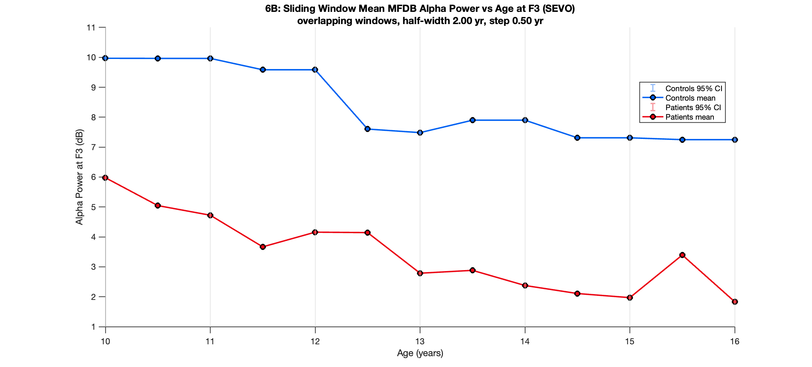
**Fig 3.** Alpha power vs age: Alpha (8–13 Hz), 4-year sliding windows.

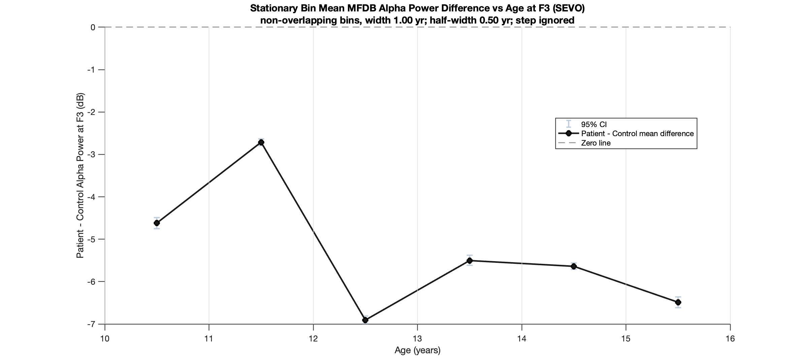
**Fig 4.** Alpha gap by age: CP − Control in 1-year bins.

### State-space model of alpha power vs age (Figs 5–6)

Smooth age curves fitted to all 24 children at once. CP alpha is ≈ 4.9 dB lower; the 95% credible band excludes zero from 11.5 to 14.9 yr.

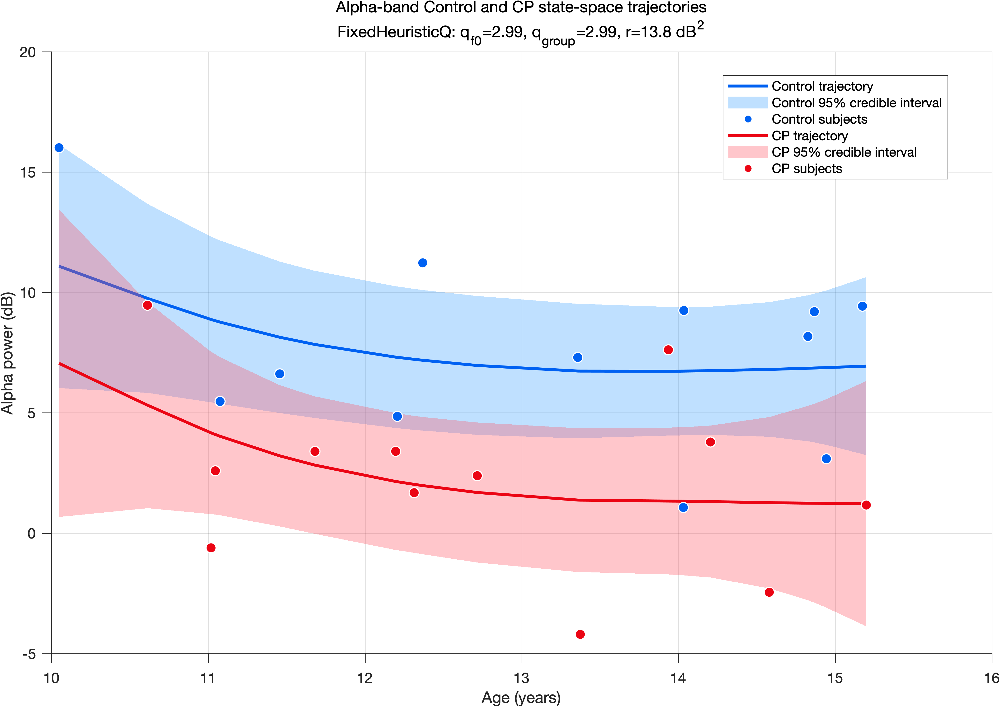
**Fig 5.** State-space trajectories: Alpha power vs age per group, 95% credible bands.

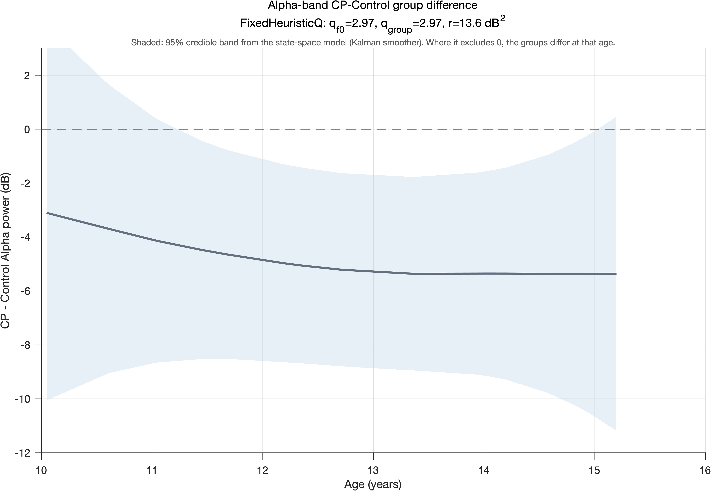
**Fig 6.** State-space gap: CP − Control vs age, 95% credible band.

### Spectrum at each age (Figs 7–8)

Descriptive: median spectrum in sliding age windows. CP is lower at almost every age, most in alpha and beta.

| | |
|---|---|
| 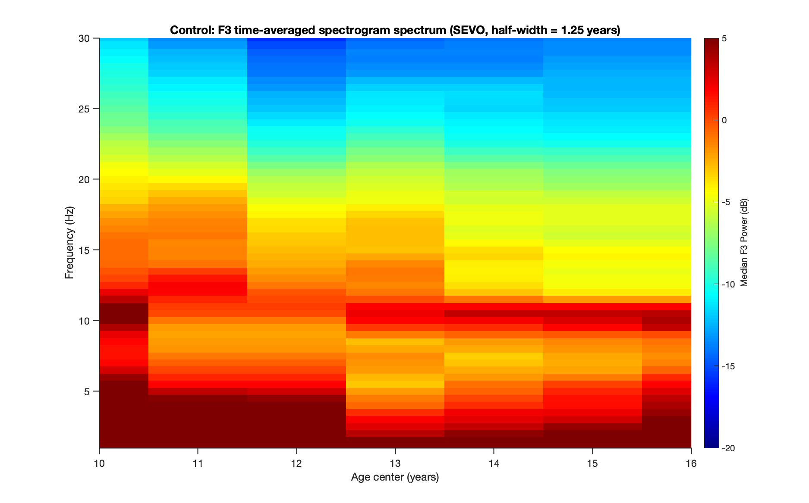 | 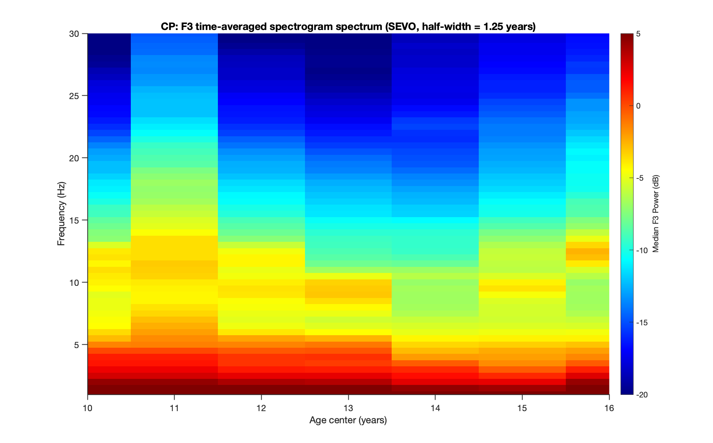 |
| **Fig 7.** Spectrogram, Control: Median spectrum in sliding age windows. | **Fig 8.** Spectrogram, CP: Median spectrum in sliding age windows. |

### F3–F4 coherence (Fig 9)

CP has lower left–right alpha coherence (median 0.49 vs 0.59); alpha is significant under every test.

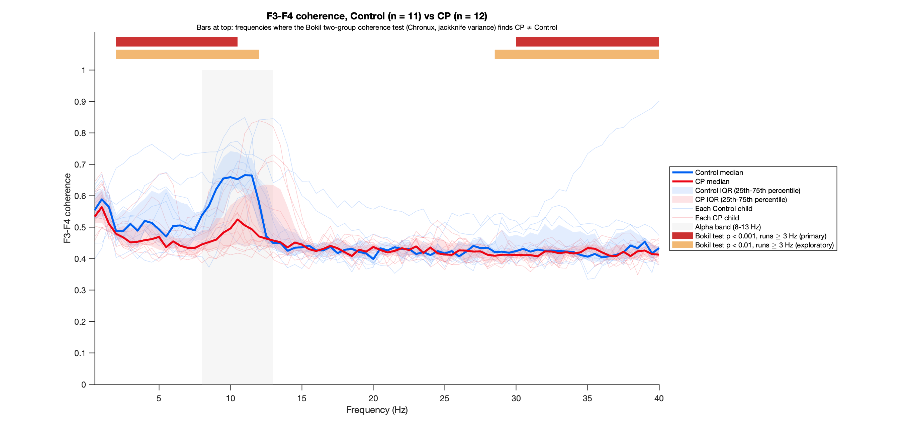
**Fig 9.** F3–F4 coherence: Coherence per group and two-group test.

### State-space model of alpha coherence vs age (Figs 10–11)

The coherence version of Figs 5–6. CP alpha coherence is ≈ 0.13 z lower; the credible band excludes zero from 12.3 to 14.9 yr.


**Fig 10.** Coherence state-space trajectories: Alpha coherence vs age per group, 95% credible bands.


**Fig 11.** Coherence state-space gap: CP − Control (Fisher z) vs age, 95% credible band.

### Coherence at each age (Figs 12–13)

The coherence version of Figs 7–8.

| | |
|---|---|
|  |  |
| **Fig 12.** Coherogram, Control: Median coherence in sliding age windows. | **Fig 13.** Coherogram, CP: Median coherence in sliding age windows. |

---

### Additional analyses

Every other figure: individual children, population-level tests, and how much the state-space results depend on smoothness. Methods for each are linked in the [figure gallery](docs/figures.md).

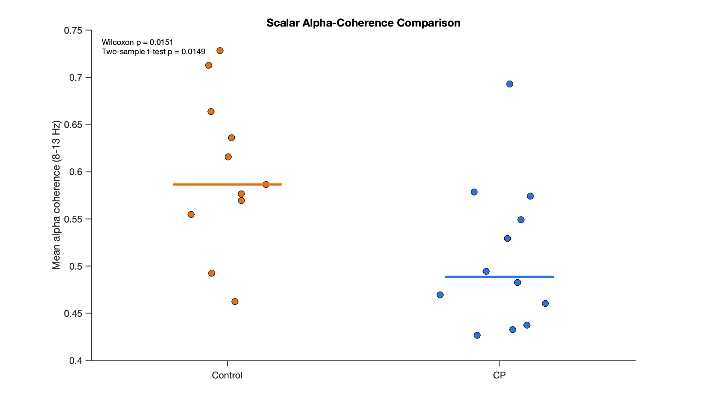
**Alpha coherence per child.** One value per child (8–13 Hz), by group.

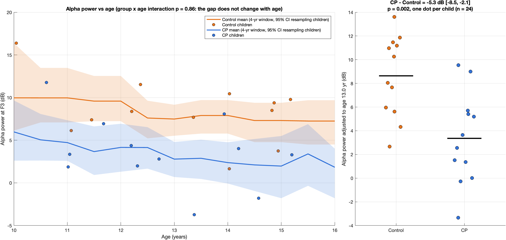
**Alpha power vs age, every child.** Every child, and age-adjusted by group.

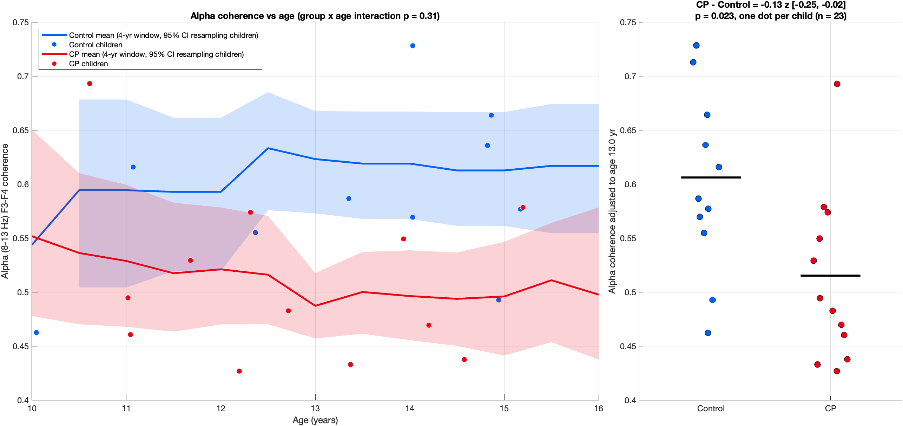
**Alpha coherence vs age, every child.** Every child, and age-adjusted by group.

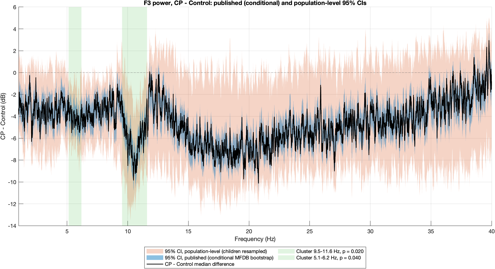
**Population-level: power.** CP − Control, CI resampling children, clusters.

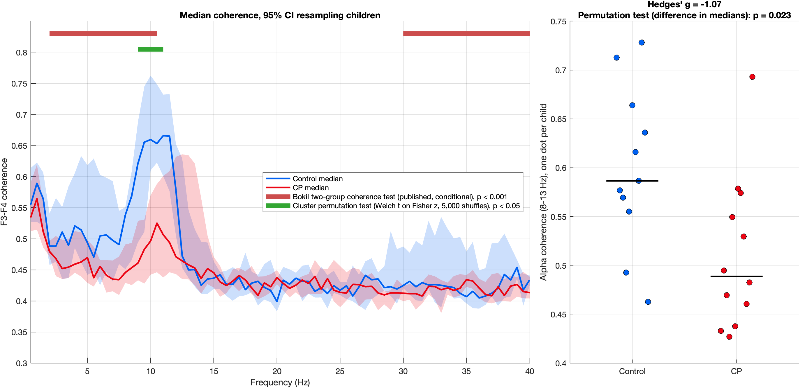
**Population-level: coherence.** CP − Control coherence, CI resampling children, clusters.


**Smoothness grid: power.** Likelihood and alpha gap across smoothness settings.


**Published vs wobbliest: power.** Alpha power, least-smooth setting the data still support.

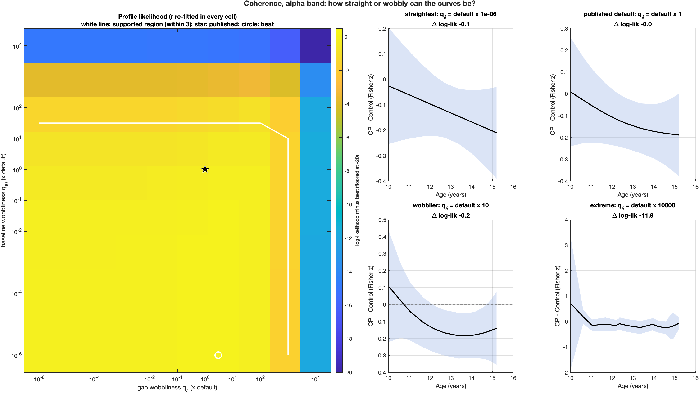
**Smoothness grid: coherence.** Likelihood and alpha gap across smoothness settings.

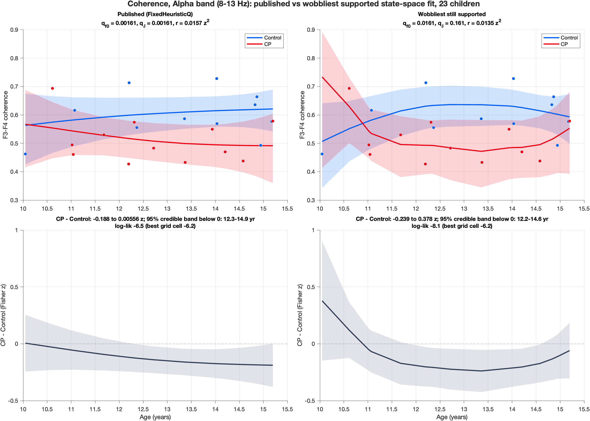
**Published vs wobbliest: coherence.** Alpha coherence, least-smooth setting the data still support.

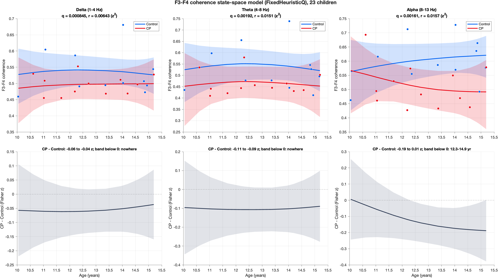
**Coherence state-space, all bands.** Delta, theta and alpha.

<!-- publication-figures:end -->
