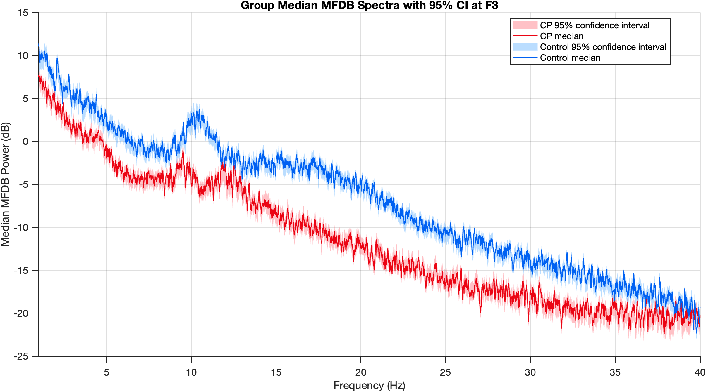
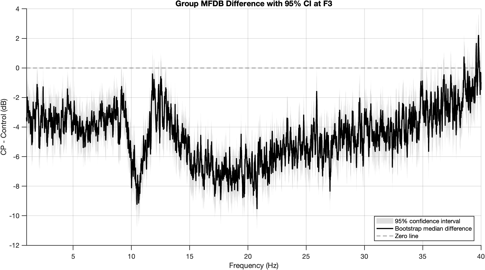
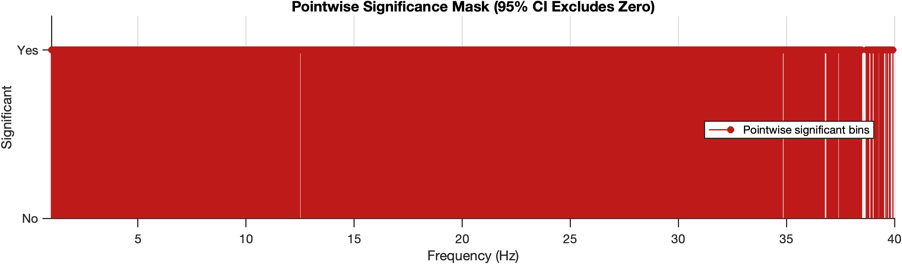
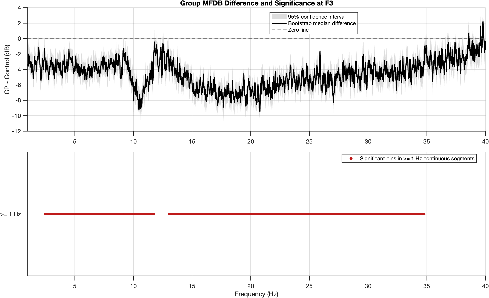

[All pages](README.md) · [Figure gallery](figures.md)

# Stage 03: group spectra, CP vs Control (Figs 1–2)

**Question this stage answers:** what does the typical CP spectrum look like next to the
typical control spectrum, and at which frequencies do they differ?

> [!IMPORTANT]
> **CP has lower F3 power than controls across most of 1–40 Hz, and most strongly in alpha (≈ −4.8 dB, 8–13 Hz).**
> The published group bootstrap (conditional on these 24 children) finds the difference at most frequencies.
> The alpha difference is significant under every method, including ones that ask whether it generalizes to new children.

| Fig 1: group median spectra, 95% CI | Fig 2: CP − Control, 95% CI |
|---|---|
|  |  |

## The method, in words
Take each child's spectrum from stage 01 and, at every frequency, find the median in each group.
The difference of the two medians is the solid line in Fig 2.
To get its uncertainty, rebuild both medians 2,000 times, each time giving every child one of their own stage 01 bootstrap spectra.

## The steps, in equations

### 1. Cohort ([lines 21–22](../analyses/primary/03_power_spectra/run_group_mfdb_bootstrap.m#L21), [39–46](../analyses/primary/03_power_spectra/run_group_mfdb_bootstrap.m#L39))
Keep only subjects in `get_cohort()` (the same cohort as every other stage): 12 + 12.
Stops with an error if any cohort subject is missing stage 01 outputs.

### 2. Observed group spectra ([Step 3](../analyses/primary/03_power_spectra/run_group_mfdb_bootstrap.m#L76))
At each frequency, the **median** across children (in dB), then CP − Control:

$$
\Delta(f) = \operatorname*{median}_{i\in CP} P_i(f) \;-\; \operatorname*{median}_{j\in Ctrl} P_j(f)
$$

No randomness.

### 3. Group bootstrap ([Step 4](../analyses/primary/03_power_spectra/run_group_mfdb_bootstrap.m#L83))
Repeat $B_{\text{group}} = 2000$ times: for **each child**, pick one of their 2,000 stage 01 bootstrap spectra at random, then recompute both medians and $\Delta(f)$.
95% CI = 2.5th–97.5th percentile.
"Significant" = CI excludes 0 at that frequency.
The plot then keeps only significant runs at least **1 Hz** wide (`contiguous_width_mask`).

## Settings
| Setting | Value | Meaning |
|---|---|---|
| Group summary | median (dB) | robust to one unusual child |
| $B_{\text{group}}$ | 2000 | bootstrap rebuilds of the group medians |
| CI | 95% (2.5th–97.5th percentile) | per frequency |
| Minimum significant run | 1 Hz | shorter runs are not marked |

## Two kinds of inference (both valid; they answer different questions)
**Published (primary): conditional inference given these children.**
The group bootstrap redraws each child's spectrum from its MFDB bootstrap (Kim et al. 2018), keeping the 24 children fixed.
The CI answers: *given these recordings, is the CP − Control difference larger than spectral-estimation uncertainty?*
With 2 minutes of EEG per child that uncertainty is small, so the CI is narrow (≈ 3 dB) and most frequencies differ.

**Complementary: population-level inference.**
Resample *children* instead, asking whether the difference would generalize to a new sample of children.
Different question, wider intervals by design.
The tested version, with a formal cluster permutation test, is in [additional_subject_level_inference.md](additional_subject_level_inference.md).

<b>Early comparison of four methods</b>

From an early check (a private check script, `scripts/group_inference_check.m`):

| Method | Question | CI width | Significant ≥ 1 Hz runs |
|---|---|---|---|
| **Published MFDB group bootstrap** | these children, beyond estimation error | 3.0 dB | most of 1–40 Hz |
| Subject bootstrap | new children | 9.6 dB | 9.9–11.5 Hz |
| Two-stage (subjects + MFDB) | new children, incl. estimation error | 9.5 dB | 9.8–11.4 Hz |
| Label permutation (pointwise) | new children | – | 9.8–11.5, 21.2–22.4 Hz |

**Where they agree:** CP has lower alpha power (≈ −4.8 dB, 8–13 Hz, mean across children); the alpha band is significant under every method.
**What the population-level view adds:** the alpha effect specifically generalizes beyond these 24 children.
Also, the two-stage bootstrap set aside as "unstable at n = 19" is stable at n = 24.

<b>More figures: significance mask</b>

## Questions to revisit
- Why median rather than mean across children? (Robust to outliers, fine, but say so in methods.)
- The 1 Hz minimum-width rule is a heuristic; with a cluster test it becomes unnecessary.

## Code and files
- **Code:** [run_group_mfdb_bootstrap.m](../analyses/primary/03_power_spectra/run_group_mfdb_bootstrap.m)
  → [plot_group_mfdb_results.m](../analyses/primary/03_power_spectra/plot_group_mfdb_results.m).
- **Input:** stage 01 120 s spectra (validated) + stage 02 cohort table.
- **Output:** `outputs/mfdb_group_level/group_mfdb_bootstrap_results.mat` + 4 PNGs (`01_`…`04_`).

---
[← 02_cohort](02_cohort.md) · [04_age_trajectories →](04_age_trajectories.md)
