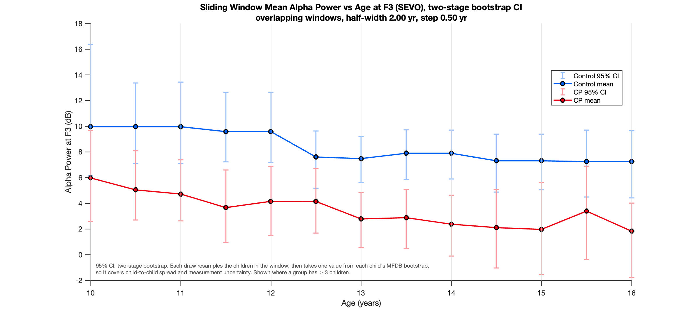
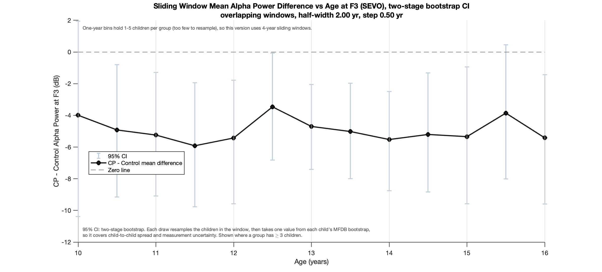

[All pages](README.md) · [Figure gallery](figures.md)

# Stage 04: alpha power vs age (additional Figs A1–A2)

**Question this stage answers:** how does alpha power change with age in each group,
and how big is the CP − Control gap at each age?

> [!IMPORTANT]
> **CP alpha power (8–13 Hz) is lower than controls in every age window from 10 to 16.**
> One regression over all 24 children gives CP − Control = −5.3 dB [−8.5, −2.1], p = 0.002, and the gap does not change with age (p = 0.86).
> The figures show two-stage bootstrap CIs, which include child-to-child spread. The published MFDB-only CIs (≈ ±0.04 dB) are still computed but not shown, because they are too narrow to see.
> These figures are now additional (A1–A2), and the main paper shows age effects through the state-space model (Figs 3–4).

| Fig A1: alpha power, 4-year sliding windows | Fig A2: CP − Control, 4-year sliding windows |
|---|---|
|  |  |

## The method, in words
Give each child one alpha number, the area under their spectrum from 8 to 13 Hz.
Group children by age, average within each group and window, and compare.
The error bars come from each child's own bootstrap spectra (stage 01), so they show how precisely each window's mean is measured for these children.

## The steps, in equations
1. **One alpha number per child** ([lines 144–150](../analyses/primary/04_age_trajectories/plot_mfdb_alpha_power_vs_age.m#L144)):
   $P_\alpha = 10\log_{10}\int_{8}^{13} \hat S(f) df$, plus the same integral on each of the 2,000 bootstrap spectra.
2. **Age windows.**
   - Fig A1: **sliding** windows, half-width 2 yr, step 0.5 yr (each child counts in up to 8 windows).
   - Fig A2: **stationary** 1-yr bins (each child in exactly one bin).
3. **Window summary.** The mean $P_\alpha$ of the children in the window (for Fig A2, CP mean − Control mean).
4. **MFDB-only CI (as published).** For each of 2,000 draws, one bootstrap value is picked per child in the window and the mean (or difference) is recomputed. The CI spans the 2.5th to 97.5th percentiles.
5. **Two-stage CI** ([two_stage_window_ci.m](../shared/stats/two_stage_window_ci.m)). Each draw first resamples the children in the window (with replacement, within each group), then picks one bootstrap value per resampled child.
   Shown only where a group has ≥ 3 children. The 1-year bins never have 3 children in both groups, so the two-stage Fig A2 uses the 4-year sliding windows.

## Settings
| Setting | Value | Meaning |
|---|---|---|
| Alpha band | 8–13 Hz | from the full 120 s spectrum (stage 01) |
| Fig A1 windows | half-width 2 yr, step 0.5 yr | smooth curve; children reused across windows |
| Fig A2 bins | 1 yr, centres 10.5–15.5 yr | each child in one bin; 1–5 children per group per bin |
| MFDB-only CI | 95%, 2,000 draws of each child's bootstrap | conditional on these children |
| Two-stage CI | 95%, 2,000 draws: children resampled, then each child's bootstrap | ≥ 3 children per group |

## 🐞 Bug found and fixed: CIs were built from the wrong children
Line 167 of the original script (the fix is at [line 179](../analyses/primary/04_age_trajectories/plot_mfdb_alpha_power_vs_age.m#L179) here) re-sorted the subject table by group, but **not** the list of bootstrap values.
The registry says "CP" and the table says "Patient", so the two lists were in different orders, and each group's CI was computed from other children's draws.

<b>Proof, and the fix</b>

**Proof** (a private check script, `scripts/stage04_ci_bug_check.m`), same 19 subjects as May:

| | Original code (= May outputs) | Fixed |
|---|---|---|
| Alpha power per child, window means | identical | identical |
| Fig A1 CIs containing their own mean | **0%** | 100% |
| Fig A2 CIs containing their own difference | **0%** | 100% |

The fix is `[results, sortOrder] = sortrows(...)`, followed by reordering the bootstrap cells the same way.
The estimates (lines in the figures) never changed, only the error bars.

## After the fix: what the CIs mean
With the bug fixed, the MFDB-only CIs follow the published (conditional) logic, in which each window's uncertainty comes from the children's MFDB bootstrap draws.
With 2 minutes of EEG per child that estimation uncertainty is small, so the bars are ≈ ±0.04 dB and barely visible.
That answers *"given these children, how precisely is each window's mean measured?"*
The old wide bars were not a different method. They came from the bug, which used other children's draws.

**How realistic is the MFDB-only uncertainty?** Each child also has four separate 30 s pieces (stage 02), so we can compare the bootstrap with real repeat measurements:

| Within one child (median of 24) | SD of alpha power |
|---|---|
| MFDB bootstrap, full 120 s | 0.05 dB |
| MFDB bootstrap, one 30 s piece | 0.12 dB |
| Actual spread of the four 30 s pieces | **0.40 dB** (up to 1.8 dB) |
| Child-to-child spread | ≈ 3 dB |

The bootstrap assumes the 2 minutes are stationary, whereas real alpha drifts about 3 times more than that within a recording.
The two-stage CI adds child-to-child spread, which is far larger still (≈ ±2–4 dB per window).

**Complementary population-level view** (see [additional_subject_level_inference.md](additional_subject_level_inference.md)):
one regression over all 24 children gives CP − Control = −5.3 dB [−8.5, −2.1], p = 0.002, with no change across ages (interaction p = 0.86).
Some one-year bins hold only 1–3 children per group, so the age-adjusted model is a useful companion to the per-bin figure.

## Code and files
- **Code:** [plot_mfdb_alpha_power_vs_age.m](../analyses/primary/04_age_trajectories/plot_mfdb_alpha_power_vs_age.m) (Fig A1)
  · [plot_mfdb_alpha_power_difference_vs_age.m](../analyses/primary/04_age_trajectories/plot_mfdb_alpha_power_difference_vs_age.m) (Fig A2).
- **Input:** stage 01 120 s spectra + `get_cohort()`.
- **Output:** `outputs/mfdb_alpha_power_vs_age/`, `outputs/mfdb_alpha_power_difference_vs_age/`.

---
[← 03_power_spectra](03_power_spectra.md) · [05_coherence →](05_coherence.md)
