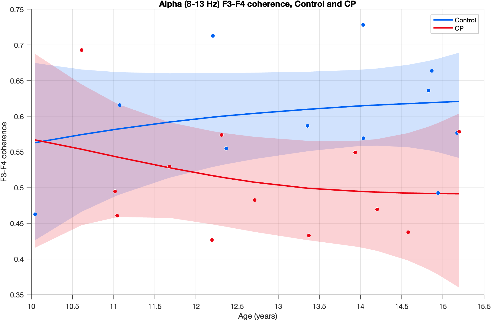
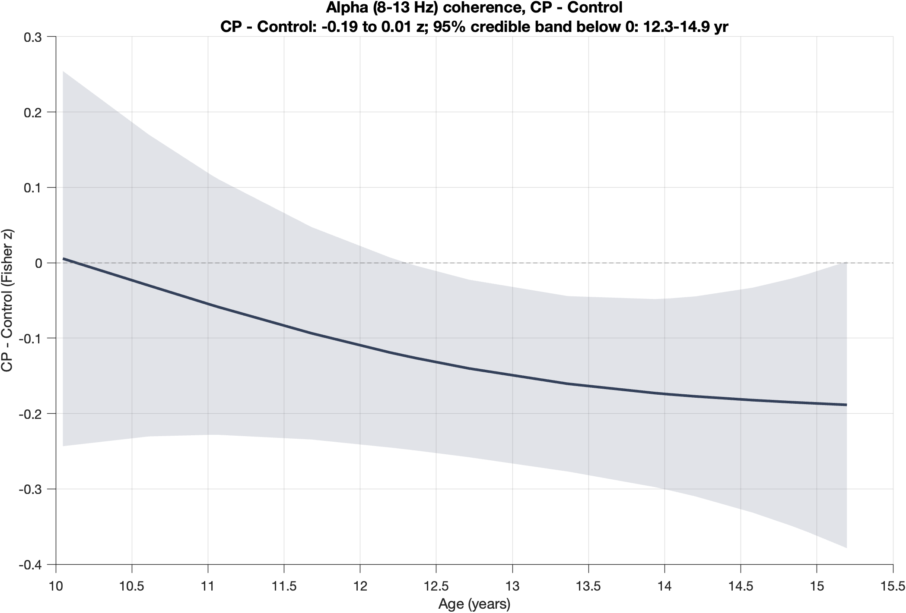
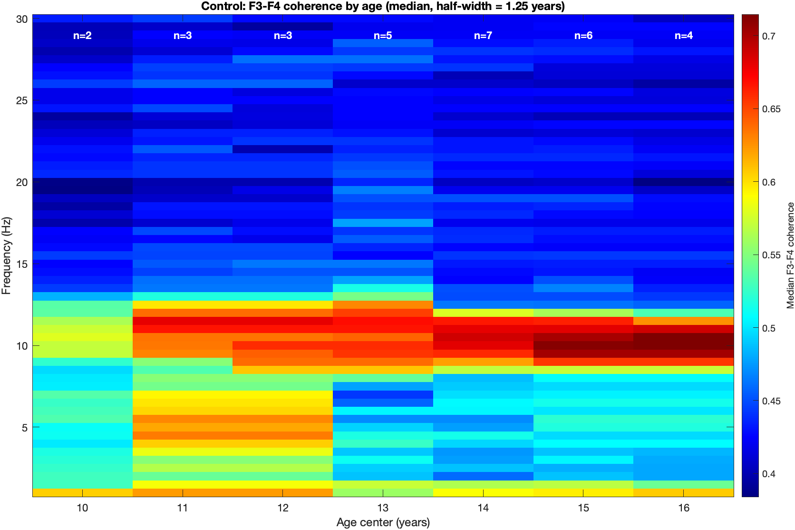
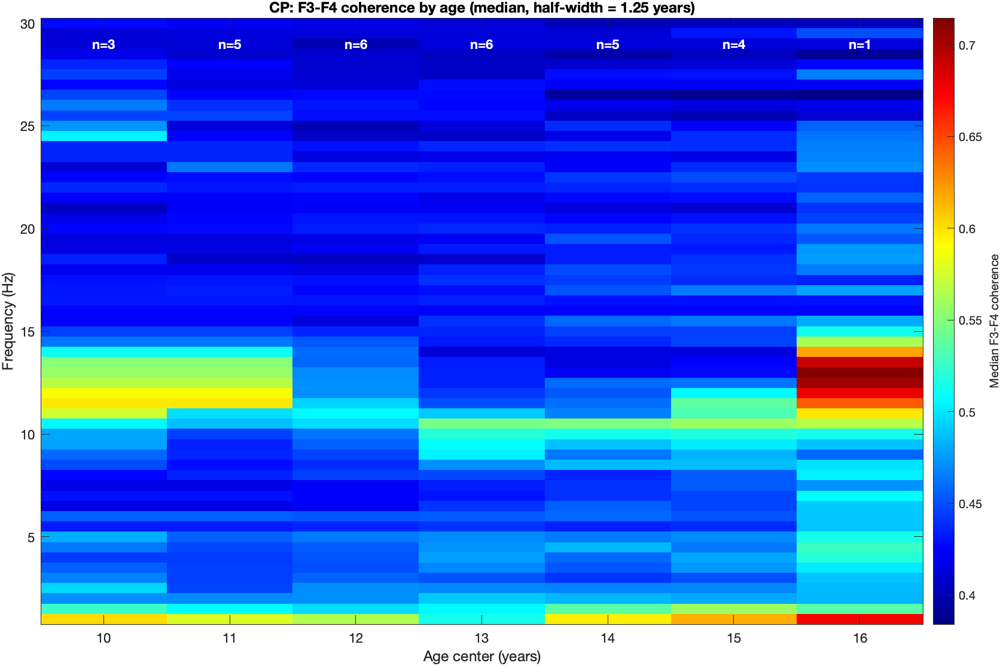

[All pages](README.md) · [Figure gallery](figures.md)

# Additional analysis: coherence counterparts of the power figures (2026-10-20)

> [!IMPORTANT]
> **CP has lower left–right alpha coherence (≈ −0.13 z, about 0.49 vs 0.59–0.61) by every method, and the gap is stable with age.**
> Delta and theta coherence show no reliable difference, so the coherence effect is alpha-specific.

| Fig 8: coherence state-space trajectories (alpha) | Fig 9: CP − Control coherence gap |
|---|---|
|  |  |

| Fig 10: coherogram, Control | Fig 11: coherogram, CP |
|---|---|
|  |  |

**Why.** A collaborator asked for a coherence counterpart of every power figure, within reason. The MFDB-based
power figures (Figs 1–2 and A1–A2) are excluded. The work started from her suggestion that the
state-space analysis done for power could also be done for coherence.
**Code:** [analyses/additional/coherence_state_space/](../analyses/additional/coherence_state_space).
Everything runs with `run_coherence_figures.m` (after `run_all.m`). The smoothness grid and gallery use the
power code with the measure `"coherence"` ([ssm_measure.m](../analyses/additional/ssm_smoothness_grid/ssm_measure.m)).

## Power figure → coherence counterpart
| Power figure | Coherence counterpart | Figure |
|---|---|---|
| Figs 1–2, 3–4 (MFDB) | excluded; Fig 7 already shows group coherence curves | — |
| Figs 5–6 age-varying spectrograms | **age-varying coherograms** (**Figs 10–11**) | [coherograms](figures/additional/coherence/coherograms.png) |
| Alpha power vs age, every child + age-adjusted | **alpha coherence vs age** (8–13 Hz) | [alpha vs age](figures/additional/coherence/alpha_coherence_vs_age.png) |
| Figs 3–4 state-space trajectories and gap | **coherence state-space** (**Figs 8–9**, alpha); delta/theta/alpha together in additional | [all bands](figures/additional/coherence/coherence_state_space_all_bands.png) |
| Smoothness grid + published-vs-wobbliest gallery | same, for coherence | [alpha gallery](figures/additional/coherence/gallery_alpha.png), [alpha grid](figures/additional/coherence/smoothness_grid_alpha.png) |
| Population-level spectra with clusters | already exists (`subject_level_inference/coherence`) | — |

## Method
- Each child's band coherence is the mean of the stage 05 coherence curve over the band,
  $\bar C_i = \text{mean}_{f \in \text{band}} C_i(f)$. For 8–13 Hz this reproduces the stage 05 alpha value exactly.
- Coherence is analysed after the Fisher transform $z_i = \mathrm{atanh}(\bar C_i)$ and plotted back on the
  coherence scale with $C = \tanh(z)$.
- The state-space model is the one used in [stage 06](06_state_space_model.md), with $y_k = z_k$ and the same bands as
  for power (alpha 8–13 Hz).
- **Two settings are specific to coherence.**
  1. The Profile-q grid is scaled to each band's default q, because coherence z values are about 30 times smaller than power in dB.
  2. Bayes factors are reported at a prior SD of **0.3 z**, about three times the spread between children. The default
     prior (SD 10, suitable for dB) is far too wide for z and penalizes any gap (Lindley's paradox).
- The coherograms use the windows of stage 07 (centres 10–16 yr, ±1.25 yr), with the median per window over 1–30 Hz.
- Alpha coherence vs age (8–13 Hz, the stage 05 band) follows the layout of the power version. The left panel shows
  the mean z in 4-year sliding windows (half-width 2 yr, step 0.5 yr) with a children-resampled 95% CI, drawn only where
  a window has at least 3 children. The regression is $z = \beta_0 + \beta_1 \text{CP} + \beta_2 \text{age}$. The right
  panel shows each child's z adjusted to the mean age, $z_i - \hat\beta_2(\text{age}_i - \overline{\text{age}})$,
  displayed as $\tanh(\cdot)$.

## Statistical tests on this page
A p-value is the probability of a difference at least as large as the one observed, if there were no real group difference. Each p-value on this page names its test, which is explained here.

| Test | What it shows |
|---|---|
| 95% credible band | Comes from the state-space model's posterior distribution, not from a hypothesis test, so it has no p-value. Where the band for the gap excludes 0, the model is at least 95% certain of the gap's sign at that age. |
| Linear regression t-test | Fits $y = \beta_0 + \beta_1 \text{CP} + \beta_2 \text{age}$ to one value per child. The p-value for CP tests whether the groups differ after adjusting for age. Adding a group × age term tests whether the gap changes with age. |
| Subject bootstrap 95% CI | Resamples the children themselves, with replacement within each group, and recomputes the statistic. The CI shows how much the result would change with a different sample of children. |
| Bayes factor | The ratio of how well two models predict the data. A Bayes factor of 16 means the data are 16 times more likely under a constant gap than under no gap. Its value depends on the prior on the gap. |
| Profile-likelihood region | A smoothness setting counts as supported when its log-likelihood is within 3 units of the best, which is approximately a 95% likelihood-ratio region for two parameters. |

## Results (23 children: 11 Control, 12 CP)
**State-space model.** The FixedHeuristicQ fit is shown, and all four versions agree.
| Band | CP − Control | 95% credible band below 0 | Group difference, p (linear regression) | Group × age, p (linear regression) |
|---|---|---|---|---|
| Delta | −0.05 z | nowhere | p = 0.14 | p = 0.85 |
| Theta | −0.10 z | nowhere | p = 0.07 | p = 0.97 |
| **Alpha** | **−0.13 z** | **12.3–14.9 yr** | **p = 0.023** | p = 0.31 |

**Smoothness grid.** In every band the published setting lies within 0.27–0.37 log-likelihood units of the best,
with 64–72 supported cells. The alpha gap is −0.12 to −0.14 z in **every** supported cell and always excludes zero.
The delta and theta gaps never exclude zero.

**Gap shape** (prior SD 0.3 z). For alpha a **constant gap** fits best, with a log Bayes factor of **+0.9** against no
gap (about 2.5 : 1, weak evidence) and a gap of −0.13 z (95% CrI −0.23 to −0.02). It is preferred over a widening or
flexible gap by about 5 : 1. Delta (−1.1) and theta (−0.2) favour **no gap**. With 8–12 Hz the constant gap was
favoured about 7 : 1, and adding 12–13 Hz makes the gap slightly smaller (−0.16 to −0.13 z).

**Least-smooth supported fit.** The alpha gap stays below zero from 12.2 to 14.6 yr. The swing at 10–11 yr is driven
by the youngest one or two children. Delta and theta remain non-significant.

**Alpha coherence vs age (8–13 Hz).** CP − Control is −0.13 z [−0.25, −0.02] (linear regression, p = 0.023), with no
evidence that the gap changes with age (group × age interaction, p = 0.31).

**Coherograms.** Controls show a strong 9–12 Hz band that strengthens with age, and this band is much weaker in CP.
The edge windows hold few children (the CP window at 16 yr contains **one child**), so the edge columns should be
treated as anecdotal.

## What this means
1. **CP has lower alpha coherence** by about 0.13 z (roughly 0.49 vs 0.59–0.61), under every method.
2. **The effect is specific to alpha.** Delta and theta show no reliable difference, unlike power, where they were
   also lower but less strongly.
3. **The gap is best described as constant with age.** The default-smoothness curve suggests a widening gap, but
   neither the regression (group × age interaction, p = 0.31) nor the gap-shape comparison (constant preferred about 5 : 1) supports it.
4. Power and coherence tell the same story, a focused and age-stable alpha deficit, now seen in both power and
   left–right coupling.

---
[← additional_ssm_smoothness_grid](additional_ssm_smoothness_grid.md)
