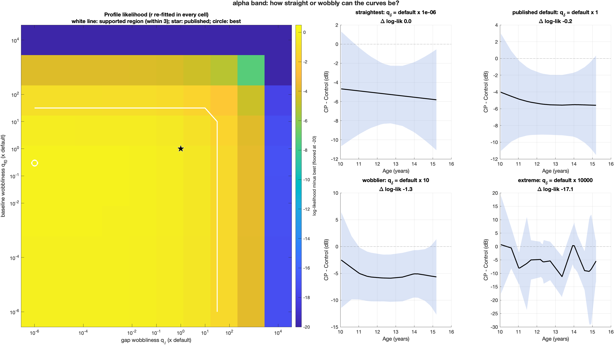
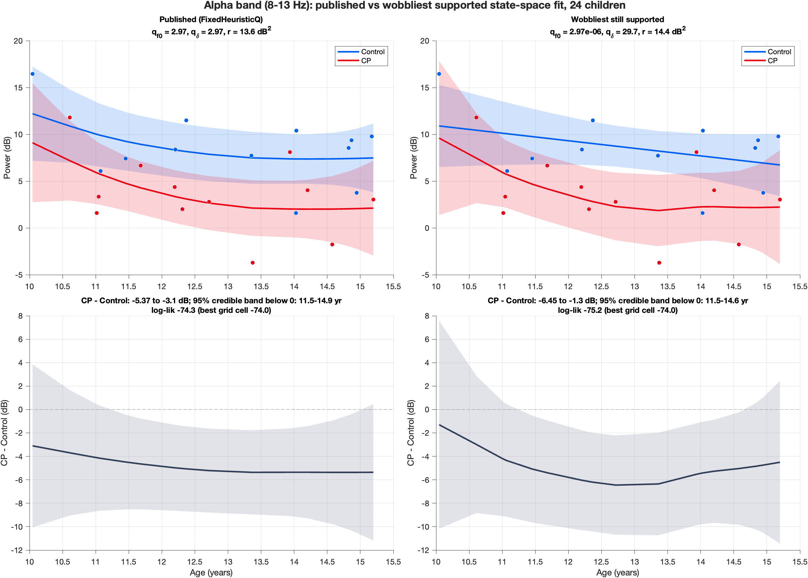

[All pages](README.md) · [Figure gallery](figures.md)

# Additional analysis: state-space smoothness grid (2026-10-20)

**Question:** how much does the state-space result (Figs 5–6) depend on how smooth the curves are allowed to be?

> [!IMPORTANT]
> **Not much.** The published smoothness sits on the flat top of the likelihood in every band.
> Across every setting the data support, the alpha gap stays between −4.7 and −5.2 dB and always excludes zero.
> The best-supported shape is a constant gap: CP −5.0 dB at all ages [−7.9, −2.1], Bayes factor ≈ 16 vs no difference.

| Smoothness grid (alpha) | Published vs wobbliest supported (alpha) |
|---|---|
|  |  |

**Code:** [analyses/additional/ssm_smoothness_grid/](../analyses/additional/ssm_smoothness_grid) · figures
in `outputs/additional/ssm_smoothness_grid/<band>/smoothness_grid.png`

## Why
We wanted a small but intelligent search of how straight or wobbly the curves could be.
What existed before (checked 2026-10-20):
| Earlier search | Limitation |
|---|---|
| `run_power_ssm_q_sweep`, `run_power_ssm_q_grid_2d` | Old **19-subject** cohort (July 9); 2-D grid alpha only, 0.1–10× (no extremes) |
| Profile-q inside stage 06 | Current cohort and wide range, but **`r` held fixed**, so not a true profile likelihood |
| `q_delta_wobble_sweep` | Alpha only, `q_f0` and `r` fixed, no saved outputs |
| Never varied | prior on the starting state, minimum age-gap floor, constant/no-gap models |

## How (equations unchanged from [stage 06](06_state_space_model.md))
- Grid $q_{f0}, q_\delta \in q_{\text{init}} \times \{10^{-6}, 10^{-4}, 10^{-2}, 0.1, 0.3, 1, 3, 10, 10^{2}, 10^{4}\}$, with
  $q_{\text{init}} = (\text{power range})^2/(\text{age span})^3$. Log spacing covers "essentially straight" to "follows every child".
- In each cell, $\hat r = \arg\max_r \log L(q_{f0}, q_\delta, r)$ (1-D search), so
  $\ell_p(q_{f0}, q_\delta) = \max_r \log L$ is a **profile likelihood**. (EM's E-step was near-singular at tiny $q$; direct
  maximization avoids that and matches EM exactly at the published setting: $\hat r = 13.594$, $\log L = -74.280$.)
- **Supported region:** $\ell_p \ge \ell_{\max} - 3$ (likelihood-ratio ≈ 95% region for 2 parameters, $\chi^2_{2,0.95}/2 = 3.0$).
- **Gap shapes** (baseline at its best $q_{f0}$), compared by marginal likelihood:
  flexible / straight line ($q_\delta \to 0$) / constant ($q_\delta \to 0$ and gap slope fixed at 0) / no gap (gap fixed at 0).
  $\log \text{BF} = \log L_{\text{shape}} - \log L_{\text{no gap}}$. Bayes factors depend on the prior on the gap
  (Lindley), so each is computed at prior SD 3, 10 and 30 dB.

## Results (24 children; alpha 8–13 Hz)
| | Delta | Theta | **Alpha** |
|---|---|---|---|
| Published setting vs best (log-lik) | −0.32 | −0.45 | **−0.24** |
| Supported cells / 100 | 65 | 74 | 64 |
| Mean gap, range over supported cells | −3.3 to −3.7 dB | −3.3 to −3.9 dB | **−4.7 to −5.2 dB** |
| Gap excludes 0 in every supported cell | ✅ | ✅ | ✅ |
| Best-supported shape (every band, every prior) | constant | constant | **constant** |
| Constant vs no gap, log BF (prior SD 3 / 10 / 30 dB) | 1.5 / 1.6 / 0.6 | 2.0 / 2.3 / 1.3 | **2.2 / 2.8 / 1.9** |
| Constant gap excludes 0 over | 10.0–15.2 yr | 10.0–15.2 yr | **10.0–15.2 yr** |

**Robustness of the published setting (alpha):** age-gap floor 0.01–0.2 yr changes the mean gap by ≤ 0.03 dB.
Prior SD 30 dB: −5.03 dB (vs −4.91). Prior SD 3 dB pulls the gap toward 0 (−4.4 dB), as an informative prior
centred on "no difference" should; the gap still excludes 0 from 11.7 to 14.9 yr.

## What this means
1. **The published setting is well chosen:** it sits on the flat top of the likelihood, within 0.24–0.45
   log-lik units of the best, in every band.
2. **The gap estimate doesn't depend on the smoothness choice:** across ~65 supported settings it moves by
   less than 0.6 dB, and it excludes zero in all of them.
3. **The data prefer the simplest shape, a constant gap.** In every band and every prior, a constant
   CP − Control offset beats straight-line and flexible gaps. Same conclusion as the regression
   (group × age p = 0.86) and stage 06's Profile-q boundary.
4. **Strength of evidence for a group difference** (constant gap vs none, prior SD 10 dB): alpha
   BF ≈ e^2.8 ≈ 16 (positive to strong); theta ≈ 10 (positive to strong); delta ≈ 5 (positive). Alpha is strongest,
   as everywhere else.
5. **Too wobbly is clearly worse:** at q_δ = 10⁴ × default the alpha log-likelihood drops by about 17 units.

## How this is used (decision 2026-10-20)
- **Main Figs 5–6 stay the published version** (FixedHeuristicQ). The grid shows it sits on the likelihood
  plateau, so it is a well-supported choice.
- **The wobbliest still-supported version goes to additional**, drawn next to the published one
  (`gallery_<band>.png`), to show how far the data can be pushed:

| Band | Wobbliest supported setting | Gap range | Gap below 0 |
|---|---|---|---|
| Alpha | q_f0 ≈ 0, q_δ = 10 × default (29.7) | −6.5 to −1.3 dB | 11.5–14.6 yr |
| Theta | q_f0 = 10×, q_δ = 100× (16.2, 162) | −5.8 to +1.3 dB | 11.0–15.2 yr |
| Delta | q_f0 = 3×, q_δ = 100× (4.56, 152) | −5.4 to +0.3 dB | 11.0–11.7 yr only |

- **The constant-gap result is reported in the text, not drawn** (a constant gap plots as a bare rectangle):
  *"A constant-difference model fit best (alpha: CP −5.0 dB at all ages, 95% CrI −7.9 to −2.1; Bayes factor ≈ 16
  vs no difference)."*

Methods sentence: *"A 10 × 10 profile-likelihood grid over the baseline and group-difference smoothness
parameters (10⁻⁶ to 10⁴ × the heuristic default, r re-estimated in each cell) showed a broad likelihood plateau
containing the default (Δ log L ≤ 0.45 in all bands). Across all supported settings the CP − Control difference varied by
< 0.6 dB and excluded zero; a constant-difference model was preferred in every band (alpha log BF = 3.2 vs no
difference)."*

---
[← additional_subject_level_inference](additional_subject_level_inference.md) · [additional_coherence_state_space →](additional_coherence_state_space.md)
