> Methods notes for this pipeline, exported from the authors' working notes. Equations and figures render on GitHub. [All pages](README.md)

# Figures: new pipeline vs original

Press **Cmd+Shift+V** to see the images. "New" images are read from `../outputs/`,
which the pipeline regenerates (not committed), so they only show on this computer.
Originals are copied into `figures/original/` for comparison.

> Until stages 01–02 are run end to end in the new repo, stage 03 here is computed
> from the **original** stage 01/02 outputs. It's the same code path the tests use.

## Stage 03: group spectra (Figs 1–2)

### Fig 1: group median spectra with 95% CI
| New pipeline | Original |
|---|---|
|  | 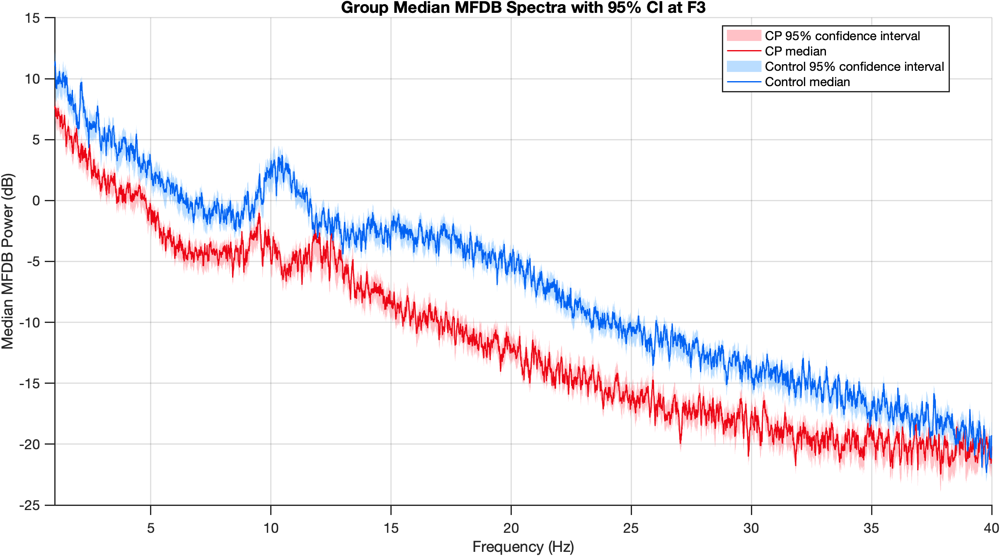 |

### Fig 2: CP − Control difference with 95% CI
| New pipeline | Original |
|---|---|
|  | 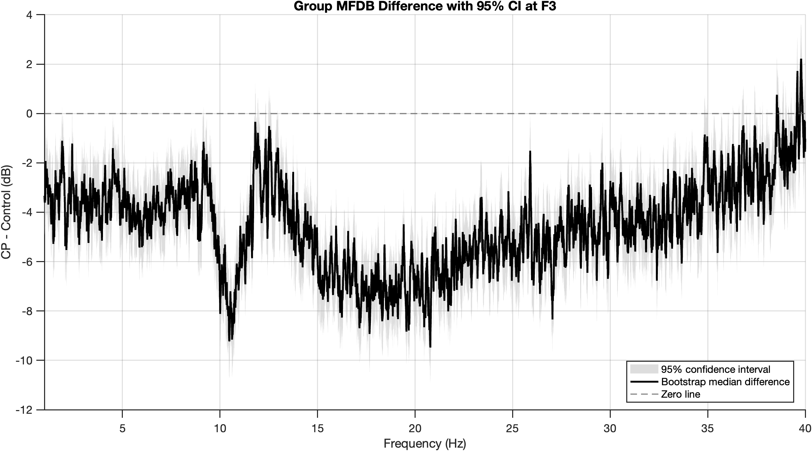 |

### Significance mask, and difference + mask
| New pipeline | Original |
|---|---|
|  | 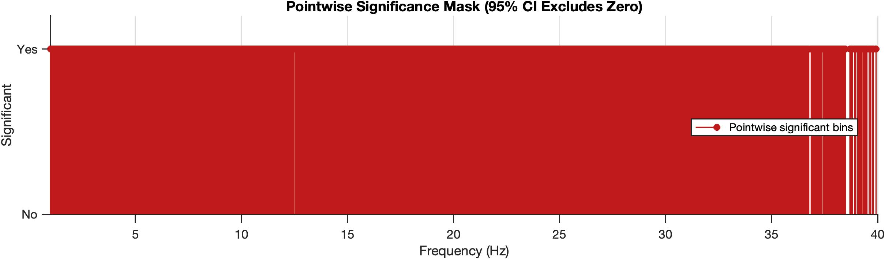 |
|  | 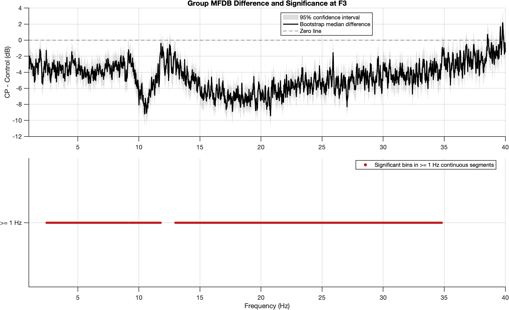 |

### Population-level comparison
See [Additional: population-level inference](#additional-population-level-inference-complementary) below.

## Stage 04: alpha power vs age (Figs 3–4)

### Fig 3: fixed, current 24-subject cohort (top) vs May original (bottom, 19 subjects, CI bug)
With the bug fixed, the bars show the conditional (MFDB) uncertainty, which is small with 2 min
of EEG per child. May's wide bars came from the bug (built from other children's draws). See [04_age_trajectories.md](04_age_trajectories.md).

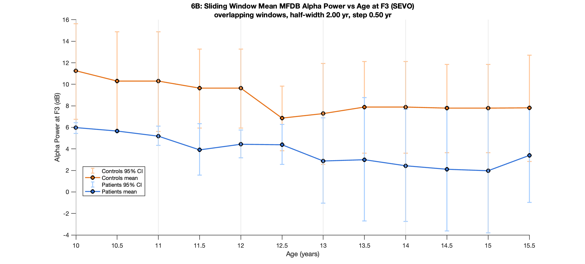

### Fig 4: CP − Control by 1-year bin, fixed (top) vs May original (bottom)

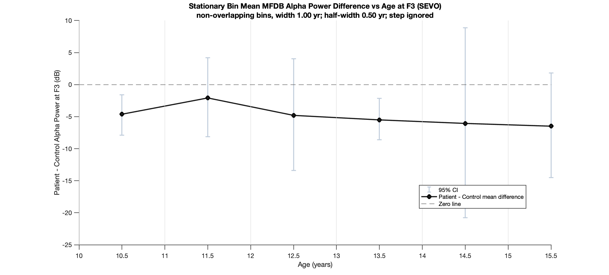

## Stage 05: F3–F4 coherence

### Group curves and significance: new (top) vs original (bottom)
The new pipeline reproduces the numbers exactly. The original PNGs are from April (older plot style/cohort).
See [05_coherence.md](05_coherence.md) for how the published Bokil test and population-level tests compare.

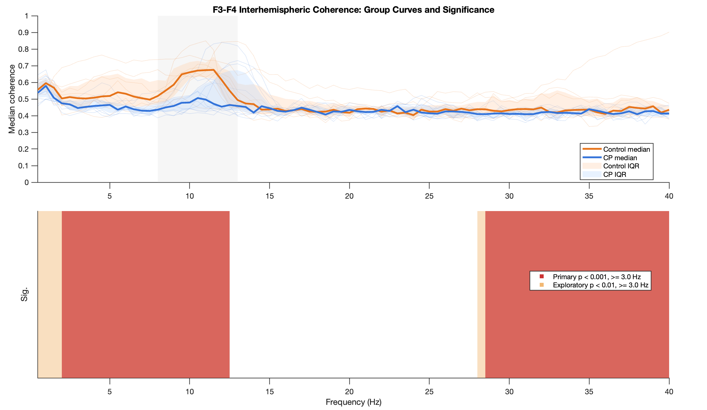

### Alpha coherence, one value per child (p ≈ 0.015)

## Stage 06: state-space model (Figs 05–06), alpha shown
Reproduced exactly (numbers identical). New (top) vs original (bottom). See [06_state_space_model.md](06_state_space_model.md).

### Fig 06: Control and CP trajectories

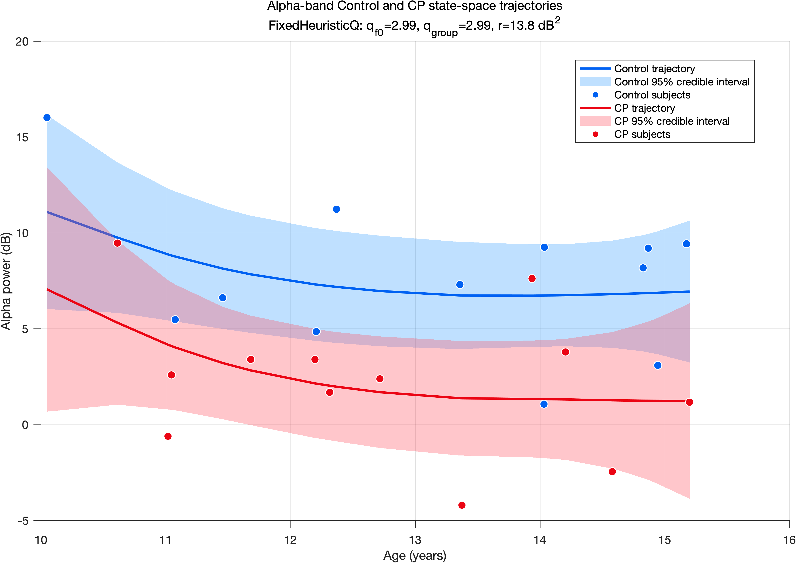

### Fig 05: CP − Control gap with 95% credible band

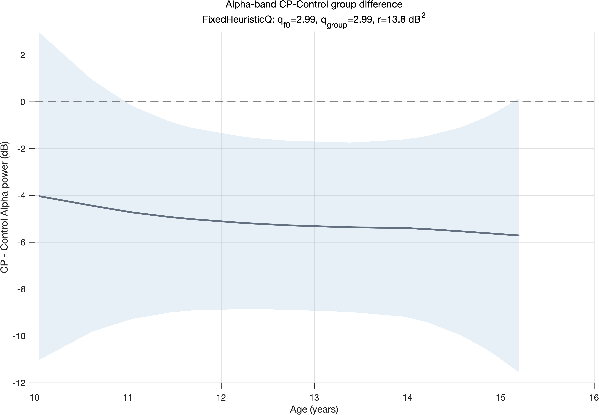

Delta and theta versions: `outputs/figures/power_ssm_24_subjects/figures/`.

## Stage 07: age-varying spectrograms (Figs 02–03)
Reproduced exactly. New (top) vs original (bottom). See [07_age_varying_spectrogram.md](07_age_varying_spectrogram.md).

### Fig 02: Control

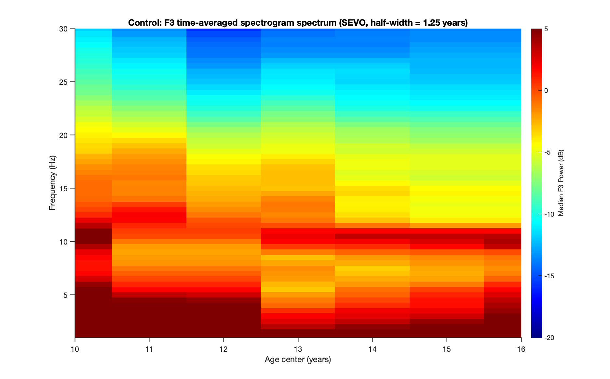

### Fig 03: CP

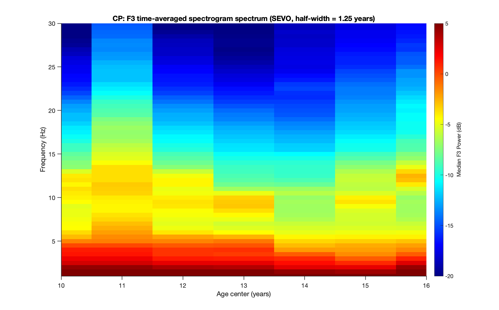

## Additional: population-level inference (complementary)
See [additional_subject_level_inference.md](additional_subject_level_inference.md).

## Additional: state-space smoothness grid (alpha)
See [additional_ssm_smoothness_grid.md](additional_ssm_smoothness_grid.md). Delta/theta: `outputs/additional/ssm_smoothness_grid/`.

## State-space gallery (published vs wobbliest supported)

## Additional: coherence counterparts of the power figures
See [additional_coherence_state_space.md](additional_coherence_state_space.md).

### State-space model, all bands (counterpart of Figs 05–06)

### Published vs wobbliest supported (alpha)

### Age-varying coherograms (counterpart of Figs 02–03)

### Alpha coherence vs age (counterpart of the age-adjusted power figure)

