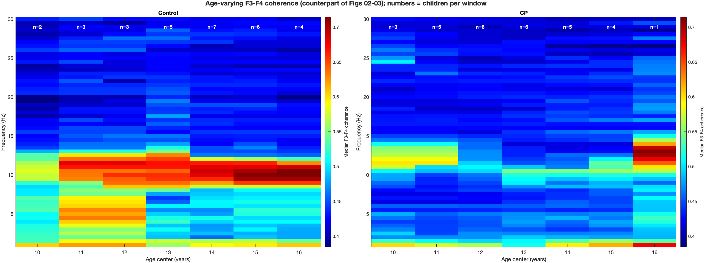

# Figure gallery

Every figure the pipeline makes, from the current run. Click a figure for
full size, or *method* for how it was made.

## Power

<table>
<tr>
<td width="50%" valign="top"> <b>Fig 1 · Group spectra</b> Median F3 power spectrum per group, 95% CI · <a href="03_power_spectra.md">method</a></td>
<td width="50%" valign="top"> <b>Fig 2 · CP − Control</b> Difference spectrum, 95% CI · <a href="03_power_spectra.md">method</a></td>
</tr>
<tr>
<td width="50%" valign="top"> <b>Fig 3 · Alpha power vs age</b> Alpha (8–13 Hz), 4-year sliding windows · <a href="04_age_trajectories.md">method</a></td>
<td width="50%" valign="top"> <b>Fig 4 · Alpha gap by age</b> CP − Control in 1-year bins · <a href="04_age_trajectories.md">method</a></td>
</tr>
<tr>
<td width="50%" valign="top"> <b>Fig 06 · State-space trajectories</b> Alpha power vs age per group, 95% credible bands · <a href="06_state_space_model.md">method</a></td>
<td width="50%" valign="top"> <b>Fig 05 · State-space gap</b> CP − Control vs age, 95% credible band · <a href="06_state_space_model.md">method</a></td>
</tr>
<tr>
<td width="50%" valign="top"> <b>Fig 02 · Spectrogram, Control</b> Median spectrum in sliding age windows · <a href="07_age_varying_spectrogram.md">method</a></td>
<td width="50%" valign="top"> <b>Fig 03 · Spectrogram, CP</b> Median spectrum in sliding age windows · <a href="07_age_varying_spectrogram.md">method</a></td>
</tr>
</table>

## Coherence

<table>
<tr>
<td width="50%" valign="top"> <b>Fig 07 · F3–F4 coherence</b> Group coherence and two-group test · <a href="05_coherence.md">method</a></td>
<td width="50%" valign="top"> <b>Alpha coherence per child</b> One value per child, by group · <a href="05_coherence.md">method</a></td>
</tr>
<tr>
<td width="50%" valign="top"> <b>State-space, all bands</b> Counterpart of Figs 05–06 · <a href="additional_coherence_state_space.md">method</a></td>
<td width="50%" valign="top"> <b>Age-varying coherograms</b> Counterpart of Figs 02–03 · <a href="additional_coherence_state_space.md">method</a></td>
</tr>
<tr>
<td width="50%" valign="top"> <b>Alpha coherence vs age</b> Every child, and age-adjusted by group · <a href="additional_coherence_state_space.md">method</a></td>
<td width="50%" valign="top"> <b>State-space: published vs wobbliest</b> Alpha, least-smooth setting the data still support · <a href="additional_coherence_state_space.md">method</a></td>
</tr>
</table>

## Additional analyses

<table>
<tr>
<td width="50%" valign="top"> <b>Population-level: power</b> CP − Control, CI resampling children · <a href="additional_subject_level_inference.md">method</a></td>
<td width="50%" valign="top"> <b>Population-level: alpha vs age</b> Every child, and age-adjusted by group · <a href="additional_subject_level_inference.md">method</a></td>
</tr>
<tr>
<td width="50%" valign="top"> <b>Population-level: coherence</b> CP − Control coherence, CI resampling children · <a href="additional_subject_level_inference.md">method</a></td>
<td width="50%" valign="top"> <b>State-space smoothness grid</b> Likelihood and alpha gap across smoothness settings · <a href="additional_ssm_smoothness_grid.md">method</a></td>
</tr>
<tr>
<td width="50%" valign="top"> <b>State-space: published vs wobbliest</b> Alpha power, least-smooth setting the data still support · <a href="additional_ssm_smoothness_grid.md">method</a></td>
</tr>
</table>
