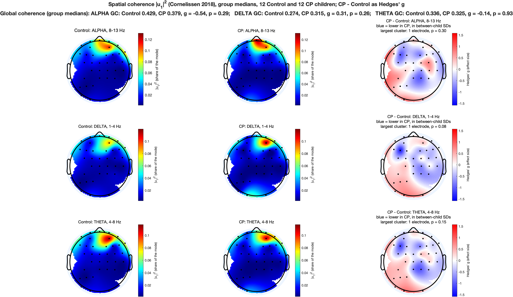
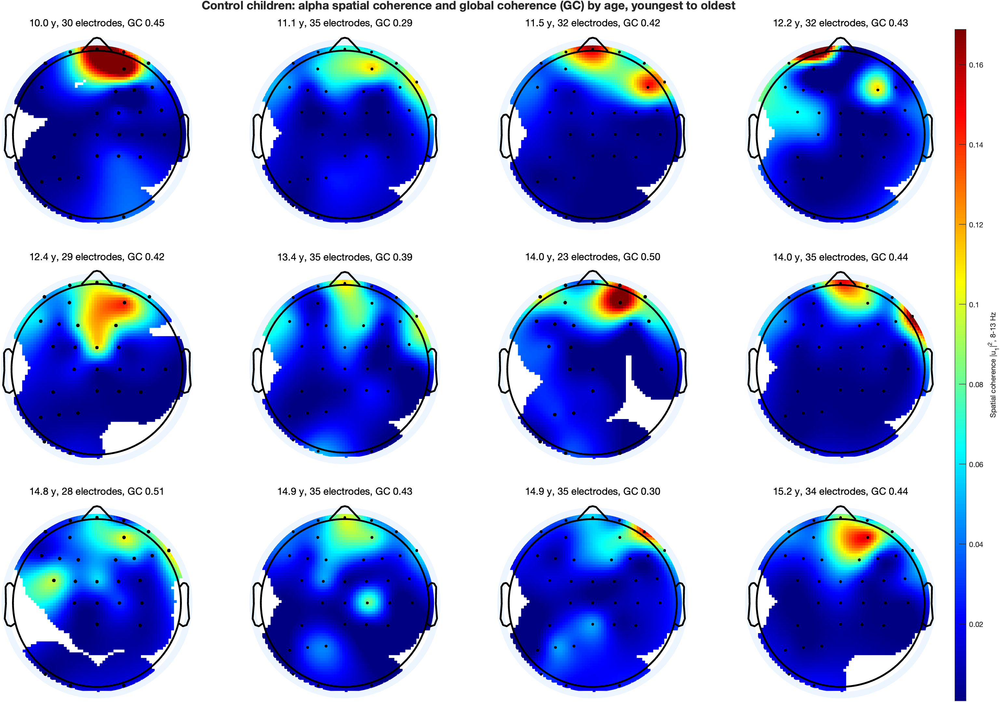
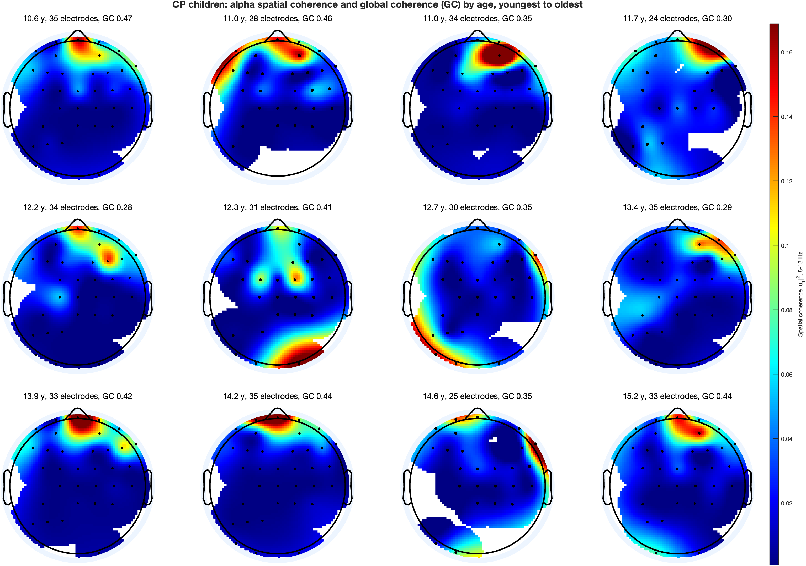
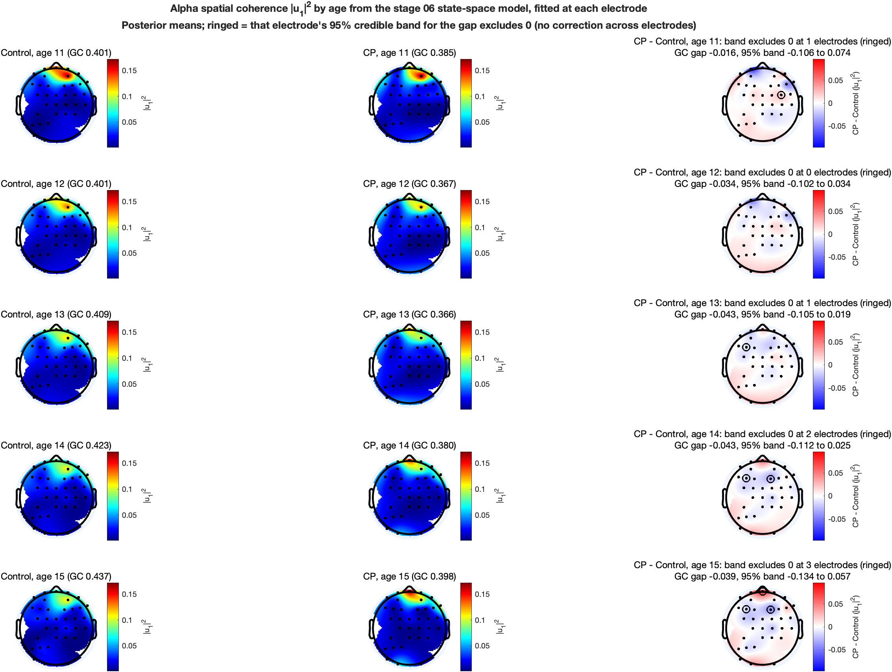

[All pages](README.md) · [Figure gallery](figures.md)

# Global coherence: how coordinated is the whole scalp?

**Code:** [analyses/additional/global_coherence/](../analyses/additional/global_coherence)
· run after `run_all.m` and the topoplots; the scripts are listed under each figure
· results in `outputs/additional/global_coherence/`

**Question:** the published coherence analysis uses one pair of electrodes, F3–F4. Across all the electrodes at
once, how much of the activity at each frequency moves together, where on the scalp is that shared activity, and
do CP and Control differ?

> [!IMPORTANT]
> **Global coherence does not differ between CP and Control.** Alpha global coherence is 0.43 in Control and 0.38
> in CP (group medians; effect size −0.54, p = 0.29). Delta (0.27 vs 0.31, p = 0.26) and theta (0.34 vs 0.32,
> p = 0.93) do not differ either. In both groups the coherent alpha, delta and theta sit over the front of the
> head, strongest at AF4. No cluster of electrodes differs between the groups (best p = 0.08). Across age, the
> state-space model puts alpha global coherence in CP about 0.04 below Control from 11 to 15 years, but the 95%
> band for the gap includes 0 at every age. These results are descriptive.

The method follows Cornelissen et al. 2018, a study of sevoflurane EEG in children aged 0 to 3. The figures have the same
layout as the band power topoplots ([topoplots.md](topoplots.md)), so the two can be read side by side.

## What global coherence measures

Coherence between two electrodes says how consistently their signals keep the same phase relation at one
frequency. Global coherence asks the same question of all the electrodes together.

At each frequency, the **cross-spectral matrix** holds the power of every electrode on its diagonal and the
cross-spectrum of every pair off it. Its eigendecomposition splits the activity into independent spatial
patterns, or **modes**. Each mode has a pattern over the electrodes (an eigenvector u) and a size (its
eigenvalue λ):

```math
S(f) = U(f)\,\Lambda(f)\,U(f)^{H}, \qquad \Lambda_{ii} = \lambda_i
```

**Global coherence** is the share of all the activity carried by the largest mode (Cimenser et al. 2011):

```math
C_{\text{global}}(f) = \frac{\lambda_{\max}(f)}{\sum_{i=1}^{N} \lambda_i(f)}
```

- If one pattern carries everything, global coherence is 1.
- If the N electrodes are unrelated, every mode is about the same size and global coherence is near 1/N (about
  0.03 with 33 electrodes).
- So a global coherence of 0.4 means the leading mode carries 40% of the activity at that frequency.

**Spatial coherence** says where that leading mode sits. It is the squared size of each electrode's entry in the
leading eigenvector, |u<sub>1</sub>|². The entries sum to 1 over the electrodes, so |u<sub>1</sub>|² is each
electrode's share of the mode. With 33 electrodes an even share is 0.03. An electrode at 0.10 carries three times
its share.

## Results

### 1. Group maps: alpha, delta and theta
`run_gc_group_topoplots.m`



The first two columns are the group median spatial coherence at each electrode. The third column is the
CP − Control difference as an effect size, as in the band power maps. The title line gives each band's global
coherence.

- **Where the coherent activity sits.** In both groups and all three bands, the leading mode is strongest over
  the right frontal electrodes: AF4 (median |u<sub>1</sub>|² about 0.11 for alpha and theta), with F8, AF8 and
  Fpz next. Central and posterior electrodes carry little of it.
- **Global coherence per band:**

  | Band | Control median | CP median | Hedges' g | Rank-sum p |
  |---|---|---|---|---|
  | Alpha, 8–13 Hz | 0.429 | 0.379 | −0.54 | 0.29 |
  | Delta, 1–4 Hz | 0.274 | 0.315 | +0.31 | 0.26 |
  | Theta, 4–8 Hz | 0.336 | 0.325 | −0.14 | 0.93 |

- **CP − Control maps.** The median effect size over electrodes is small (alpha −0.13, delta −0.18, theta −0.09).
  F3 has the largest negative values: CP carries less of the leading mode at F3 (alpha g = −1.03, delta −1.38,
  theta −1.17). F4 does not differ (alpha −0.04). No cluster reaches p < 0.05 (alpha p = 0.30, delta 0.08,
  theta 0.15, each a single electrode), so nothing is ringed.

<details>
<summary><b>How global coherence is computed (Cornelissen et al. 2018)</b></summary>

Cornelissen et al. 2018 (Br J Anaesth 120:1274) state the method in their Methods section. Each step below is
theirs. Where they give no number, the published code of the same group is used (Cornelissen et al. 2015, eLife,
Source code 1).

1. **Data.** Each child's stage 01 epoch: the same 120 s as the F3 analyses, Laplacian-referenced, 256 Hz.
2. **Windows.** Non-overlapping 2 s windows, so 60 windows. Each window is linearly detrended, as their code does.
3. **Cross-spectral matrix per window.** Multitaper with time-bandwidth 2 and 3 tapers, from their code; the 2018
   paper does not state the tapers. With 2 s windows the frequency step is 0.5 Hz and the smoothing bandwidth
   2 × 2 / 2 s = 2 Hz. For taper k, x<sub>k</sub>(f) is the vector of every electrode's tapered Fourier
   coefficient, and
   ```math
   S_w(f) = \frac{1}{K}\sum_{k=1}^{K} x_k(f)\,x_k(f)^{H}
   ```
4. **Median over 10 windows.** In each block of 10 consecutive windows, the real part and the imaginary part of
   every entry are replaced by their medians over the 10 windows, "to remove the noise artefact" (their words).
   120 s gives 6 blocks. A median rather than a mean keeps one window with an artifact from setting the result.
5. **Eigendecomposition** of each block's matrix at each frequency gives global coherence and the leading
   eigenvector.
6. **Per child.** Global coherence and |u<sub>1</sub>|² are averaged over the 6 blocks and over the band's
   frequencies. The bands are those of the power maps (delta 1–4, theta 4–8, alpha 8–13 Hz,
   `state_space_bands.m`). Cornelissen used 8–12 Hz for alpha; 8–13 keeps the maps comparable with the power maps.
7. **Groups.** Group values are the median over children, as in Cornelissen. The maps are drawn with EEGLAB's
   `topoplot`, as theirs were.

**One detail of the median.** A median taken entry by entry keeps the matrix Hermitian, but it no longer has to
be positive semi-definite, so a few eigenvalues can be slightly negative. Their code uses the singular value
decomposition, whose values are the sizes of the eigenvalues, and this code does the same. At the worst frequency
and block, the negative eigenvalues hold 9% to 13% of the total in each child (`maxNegativeShare` in
`child_gc.csv`). This is part of the published method, not something added here.

</details>

<details>
<summary><b>Which electrodes each child uses</b></summary>

Each child's global coherence uses the electrodes the band power maps draw (35; see
[topoplots.md](topoplots.md)) that are clean in that child. That gives 23 to 35 electrodes per child, with a
median of 33 in both groups.

A common set for all children is not possible: only 5 electrodes are clean in all 24.

The number matters a little. Global coherence cannot fall below 1/N, so with fewer electrodes it tends to be
higher. Across children, fewer electrodes go with somewhat higher delta and theta global coherence (Spearman
−0.40 and −0.36, p = 0.05 and 0.08) and much less so for alpha (−0.24, p = 0.27). Since the two groups have the
same median count, this adds noise to the comparison but should not push it one way.

The maps by age show every child, including the one control child with 23 electrodes that the band power maps
by age leave out. That child's global coherence counts in the group values, so their map is shown too.

</details>

<details>
<summary><b>The CP − Control column and the cluster test</b></summary>

These are the same as in the band power maps: Hedges' g at each electrode on a fixed −1.5 to 1.5 scale, and the
spatial cluster permutation test over all electrodes (5,000 shuffles). The equations and their explanation are
in [topoplots.md](topoplots.md), "The CP − Control column" and "Is a difference real?".

For the band global coherence, one value per child, the title gives the group medians, Hedges' g and a Wilcoxon
rank-sum p.

</details>

### 2. Each child by age
`plot_gc_by_age.m`

| Control | CP |
|---|---|
|  |  |

One map per child, youngest to oldest, each titled with age, number of electrodes and that child's alpha global
coherence. Both groups share one colour scale (the 2nd to 98th percentile of all values), so the figures compare.

- Alpha global coherence ranges from 0.29 to 0.51 in Control and 0.28 to 0.47 in CP.
- In most children the coherent alpha is frontal, but its exact place varies: midline, right frontal, or near
  the right temple. One control child has no clear frontal focus. Two CP children have their strongest
  electrodes at the edge of the montage (one posterior, one along the left side), where the Laplacian is
  one-sided, so those maps should be read with care.
- There is no clear trend with age in either group at this scale.

### 3. Alpha spatial coherence by age, from the state-space model
`run_gc_state_space_maps.m`



The stage 06 state-space model, with its published setting, fitted to |u<sub>1</sub>|² at every electrode
separately, then read off at ages 11 to 15. This is the method of the alpha power maps by age
([topoplots.md](topoplots.md), figure 7), applied to spatial coherence. Each map title also gives global coherence
at that age, from the same model fitted to each child's alpha global coherence.

| Age | Control GC | CP GC | CP − Control | 95% band |
|---|---|---|---|---|
| 11 | 0.401 | 0.385 | −0.016 | −0.106 to 0.074 |
| 12 | 0.401 | 0.367 | −0.034 | −0.102 to 0.034 |
| 13 | 0.409 | 0.366 | −0.043 | −0.105 to 0.019 |
| 14 | 0.423 | 0.380 | −0.043 | −0.112 to 0.025 |
| 15 | 0.437 | 0.398 | −0.039 | −0.134 to 0.057 |

- Global coherence is a little lower in CP at every age, but the band includes 0 throughout.
- The maps show the same right frontal focus in both groups at every age.
- Ringed electrodes have a 95% band for the gap that excludes 0, each judged on its own: FC4 at 11, F3 at 13,
  F3 and F2 at 14, and F3, F2 and Fpz at 15. With 35 electrodes about 2 would do this by chance at each age, so
  these are not evidence of a difference. They do agree with the group map in pointing to F3.

<details>
<summary><b>How the state-space maps are made</b></summary>

At each electrode, every child with that electrode gives one value, |u<sub>1</sub>|² in alpha. The stage 06
model (`state_space_fit.m`: fixed heuristic smoothness, observation noise by EM, then the Kalman smoother) fits a
Control curve and a CP − Control gap curve over age. The posterior means and 95% credible bands are read off at
each whole year by linear interpolation between children's ages, with no extrapolation. The full description of
the model is in [06_state_space_model.md](06_state_space_model.md) and of the per-electrode maps in
[topoplots.md](topoplots.md).

</details>

## How this was checked

- **Simulated data** (`tests/test_global_coherence.m`). A 10 Hz rhythm shared by 5 of 20 channels, on top of
  independent noise, gives global coherence above 0.9 at 10 Hz and below 0.25 at 20 Hz, and puts more than 99% of
  |u<sub>1</sub>|² on those 5 channels. |u<sub>1</sub>|² sums to 1, global coherence stays between 1/N and 1, and
  with one window per block the result equals a direct eigendecomposition.
- **Against the published code.** On one window, global coherence and |u<sub>1</sub>|² match Cornelissen's
  published cross-spectrum function and `svd` to 3 × 10⁻¹⁶ at every frequency from 0 to 30 Hz.
- **On the data.** In both groups the leading mode is frontal, where alpha power is strongest
  ([topoplots.md](topoplots.md)), as expected under sevoflurane.

## Where this differs from earlier code

Three earlier implementations exist. This one follows the 2018 Methods; the differences are listed so the
earlier results can be read correctly.

- **Cornelissen's published code (2015).** Same core. It uses 2 s windows every 3 s, skipping 1 s between
  windows, and a running median over 5 windows. The 2018 Methods say non-overlapping windows and a median over 10.
- **The earlier peds_cp version** (`GlobalCoherence_corn_sg.m`). Same core, but 20 s windows, time-bandwidth 5
  with 9 tapers, and a fixed list of 21 dropped channels. On a 120 s epoch that leaves 6 windows. It also draws a
  map of the size of the mean eigenvector (`U_topo`). Each eigenvector comes out of `svd` with an arbitrary phase,
  so averaging them is not meaningful. Its other map, the mean |u<sub>1</sub>|² (`w_topo`), is the one Cornelissen
  describes and the one used here.
- **The thesis `GC_eig.m`, method 0.** The standard global coherence of Cimenser et al. 2011 on a summed
  cross-spectral matrix. It is correct, but it has no median step, so it is not Cornelissen's version. Method 1
  also removes the mean Fourier coefficient, which neither paper does.

## Limitations

- 120 s per child gives 6 blocks of 10 windows, so each child's value rests on 6 decompositions.
- Each child uses its own set of electrodes (above).
- The Laplacian reference removes activity common to neighbouring electrodes, so global coherence here measures
  coordination beyond what volume conduction to neighbours would give. Values are not comparable with studies
  that use a common reference.
- 12 children per group, as in every analysis here, so only large differences would be detected.

---
[← topoplots](topoplots.md)
