[All pages](README.md) · [Figure gallery](figures.md)

# Topoplots: delta, theta and alpha across the scalp

**Code:** [analyses/additional/topoplots/](../analyses/additional/topoplots)
· run after `run_all.m`; the scripts are listed under each figure
· results in `outputs/additional/topoplots/`

**Question:** the published analyses use one electrode, F3. How are delta, theta and alpha power spread over the
whole scalp in each group, and where do CP and Control differ?

> [!IMPORTANT]
> **CP alpha is lower over the front of the head, not the back.** Over the frontal electrodes the CP median is
> 3.6 dB below Control (95% CI −5.1 to −0.9, p = 0.018); over the occipital electrodes the groups do not differ
> (p = 0.58). Across age, the state-space model puts frontal alpha in CP below Control throughout, with the 95%
> band for the gap excluding 0 from 11.7 to 14.2 years. Frontal theta points the same way (−2.9 dB, p = 0.068).
> Tested electrode by electrode, the differences are moderate and no cluster of electrodes reaches p < 0.05, so the
> electrode-level maps are descriptive.

Each figure has its method in the dropdowns below it. The [Additional analyses](#additional-analyses) at the end
hold the results that are descriptive or not significant.

## Results

### 1. Group maps: alpha, delta and theta
`run_group_topoplots.m`

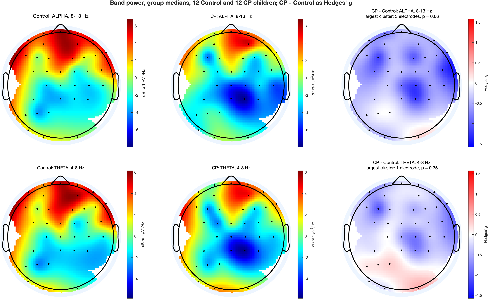

Control and CP show the group median at each electrode; the third column is the CP − Control difference as an
effect size. CP is lower over most of the scalp, most clearly for alpha (median effect size −0.56; −1.13 at F3).
No cluster of electrodes reaches p < 0.05 (best: alpha, 3 central electrodes, p = 0.057), so nothing is ringed.

<details>
<summary><b>How the maps are made</b></summary>

**Power at every electrode.** Each electrode gets the same spectrum as F3 in stage 01: multitaper, time-bandwidth
6, 11 tapers, the same 120 s of EEG, with the Laplacian reference (each electrode minus the mean of its
neighbours). The frequency resolution is 2 × 6 / 120 s = 0.1 Hz. Band power is the mean of the dB
spectrum over the band:

```math
P_{\text{band}} = \frac{1}{N_f}\sum_{f \in \text{band}} 10\log_{10} S(f)
```

with delta 1–4 Hz, theta 4–8 Hz and alpha 8–13 Hz, the same band edges as the published F3 analyses (defined once
in `state_space_bands.m`). The maps use these edges only; they do not use the state-space model. At F3 this gives
exactly the value used in the published analyses (checked for every child by the tests).

**Group maps.** At each electrode, the map shows the **median** over the children of the group. Colours between
electrodes are interpolated by EEGLAB's `topoplot`, and areas far from any drawn electrode are left blank. Control
and CP share one colour scale within each row, so the two maps can be compared by eye. Each row has its own scale,
because delta is about 10 dB stronger than alpha.

</details>

<details>
<summary><b>Which electrodes are drawn, and which children appear</b></summary>

The recordings have 58 channels. The maps draw 35.

1. **A channel is usable in a child** unless it was all zeros, or the Laplacian could use fewer than 3 neighbours
   (because neighbours were removed as bad channels). With fewer neighbours, the channel is not referenced like
   the others. Of 1,273 child × channel values, 163 have too few neighbours and 1 is all zeros.
2. **Five channels are left out for everyone**, because of recording or montage problems:
   - FT7 sits about 15 dB above every other channel at every frequency, in every child who has it.
   - F7, FC5 and T7 use FT7 as a Laplacian neighbour, so they carry its error.
   - The centro-parietal channel left of CPz has a montage entry that lists the wrong neighbour (the channel right of CPz instead of CPz).
3. **An electrode is drawn** if it is usable in at least 9 of the 12 children of **each** group. Otherwise one
   group's map would rest on too few children. This removes 18 more channels, mostly parietal, occipital and
   temporal ones (for example Pz is usable in only 4 CP children, Oz in 7).

F3 and F4, the electrodes of the published analyses, are drawn.

**Children.**
- **Group maps:** every child in the cohort (12 Control, 12 CP) counts at every drawn electrode that is usable for
  them. So the number of children differs a little between electrodes (9 to 12 per group).
- **Maps by age:** a child needs at least 24 of the 35 drawn electrodes, so their map is not mostly interpolated.
  One control child has 23 and is left out of the by-age figures (11 Control maps, 12 CP). That child still counts
  in the group maps.
- These rules apply to the maps only. The published analyses keep every child.

</details>

<details>
<summary><b>The CP − Control column: effect size (Hedges' g)</b></summary>

A difference in dB means little until you know how much children differ from each other. A gap of 2 dB is large
if every child is within 1 dB of their group, and small if children differ by 5 dB. So the third column shows the
difference in units of how much children vary, **Hedges' g**:

```math
g = \frac{\bar x_{\text{CP}} - \bar x_{\text{Control}}}{s_p}\left(1 - \frac{3}{4(n_{\text{CP}} + n_{\text{Control}}) - 9}\right),
\qquad s_p = \sqrt{\frac{(n_{\text{CP}}-1)s_{\text{CP}}^2 + (n_{\text{Control}}-1)s_{\text{Control}}^2}{n_{\text{CP}} + n_{\text{Control}} - 2}}
```

- x̄ is the group mean, s the standard deviation between children in a group, and sₚ the two pooled.
- The bracket is a small correction for having only about 12 children per group.
- g = −1 means CP is one between-child standard deviation lower. As a guide, 0.2 is small, 0.5 medium and 0.8 large.
- The colour scale is fixed at −1.5 to +1.5 for every row and figure, so a colour always means the same effect size.

g uses means, while the first two columns show medians. Medians suit the pictures because one unusual child
moves them less. Means are what the test below needs.

</details>

<details>
<summary><b>Is a difference real? The spatial cluster test</b></summary>

Testing 35 electrodes separately would find about 2 "significant" ones by chance alone (5% of 35). The
**cluster permutation test** (Maris & Oostenveld, 2007) asks the question once for the whole scalp. It is
the test used for the frequency clusters in the population-level analysis, with neighbouring electrodes in
place of neighbouring frequencies (`shared/stats/spatial_cluster_test.m`).

**Step 1. A t statistic at each electrode.** Welch's t, which does not assume equal spread in the two groups:

```math
t_e = \frac{\bar x_{\text{CP},e} - \bar x_{\text{Control},e}}{\sqrt{s_{\text{CP},e}^2 / n_{\text{CP},e} + s_{\text{Control},e}^2 / n_{\text{Control},e}}}
```

**Step 2. Clusters.** Electrodes with |t| above a threshold that are neighbours and have the same sign form a
cluster. The threshold is the t for p < 0.05 with min(n<sub>CP</sub>, n<sub>Control</sub>) − 1 = 11 degrees of
freedom, |t| > 2.20. Two electrodes are neighbours if they share an edge of a triangulation of the cap seen from
above, so each electrode has about 4 neighbours (`electrode_neighbours.m`).

**Step 3. Cluster mass.** Each cluster gets a mass, the sum of its |t| values:

```math
\text{mass} = \sum_{e \in \text{cluster}} |t_e|
```

A large mass means several neighbouring electrodes, each well above threshold.

**Step 4. What chance produces.** The CP and Control labels are shuffled 5,000 times. Each shuffle keeps every
child's whole map together and gives the largest cluster mass that random labels produce.

**Step 5. p-value.** For a real cluster, the p-value is the share of shuffles whose largest cluster is at least as big:

```math
p = \frac{1 + (\text{number of shuffles whose largest mass} \ge \text{this cluster's mass})}{5000 + 1}
```

Because each shuffle keeps only its largest cluster, the test controls false positives over all electrodes at
once: with no true difference, a cluster with p < 0.05 appears in about 5% of datasets. On simulated data with no
difference it did so in 4.0% of 200 datasets, and a planted difference on a patch of electrodes was found, in the
right place. Electrodes in a cluster with p < 0.05 are ringed on the map.

**Results**

| Measure | Median g over electrodes | g at F3 | Largest cluster | p |
|---|---|---|---|---|
| Alpha | −0.56 | −1.13 | 3 central electrodes (Cz, C2 and the centro-parietal one right of CPz) | 0.057 |
| Delta | −0.23 | −0.85 | none above threshold | — |
| Theta | −0.33 | −1.00 | F3 alone | 0.35 |
| Alpha peak vs 7 Hz | −0.45 | −0.59 | none above threshold | — |

**How to read this**
- **The electrode maps are descriptive.** They show where each band is strong and that CP is lower over most of
  the scalp, most clearly for alpha. They do not show that any one electrode differs.
- **This is not a contradiction of the F3 result.** F3 was chosen before any map was made, so it is one test with
  no correction, and alpha at F3 is lower in CP (g = −1.13). The cluster test asks a harder question, *which
  electrodes* differ, and pays for looking at 35 of them.
- **Why no cluster forms.** The alpha difference is broad and moderate rather than strong in one place. Clusters
  need neighbouring electrodes that all pass the threshold together. The Laplacian also makes neighbouring
  electrodes less alike, because each one has its neighbours subtracted, so clusters form less easily than in
  unreferenced EEG.
- The threshold (|t| > 2.20) follows the repo's frequency cluster test. It is conservative. It was not changed after
  seeing the results.

</details>

### 2. Group maps: alpha peak vs 7 Hz, with delta and theta
`run_peak_vs_7hz_topoplots.m`

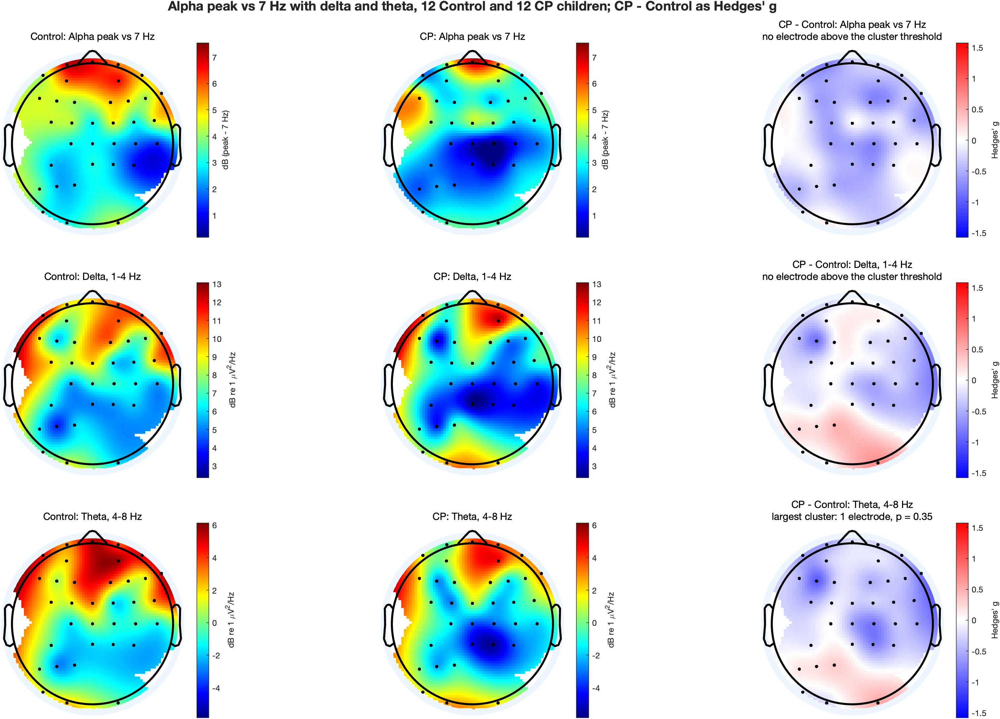

The same layout, with the height of the alpha peak in the first row. CP is somewhat lower (median effect size
−0.45), with no cluster above threshold. The effect-size and cluster-test methods are those of Figure 1.

<details>
<summary><b>How alpha peak vs 7 Hz is computed</b></summary>

Each child's alpha peak frequency f<sub>peak</sub> is found once, from the median spectrum of their clean
electrodes (the most prominent maximum from 8 to 13 Hz, `find_alpha_peak.m`). Then, at every electrode,

```math
\text{peak vs 7 Hz} = \overline{P}(f_{\text{peak}} \pm 0.5\ \text{Hz}) - \overline{P}(7 \pm 0.5\ \text{Hz})
```

in dB. It measures how tall the alpha peak stands above the dip below it. Any gain that raises the whole spectrum
cancels, because both terms rise by the same amount. 7 Hz lies in theta, so it is not pure background. The
comparison with 7 Hz comes from the lab's earlier topoplot code.

</details>

### 3. Each child by age
`plot_band_by_age.m`

One map per child, youngest to oldest. Control and CP share the colour scale of each band.

| Band | Control | CP |
|---|---|---|
| Alpha | 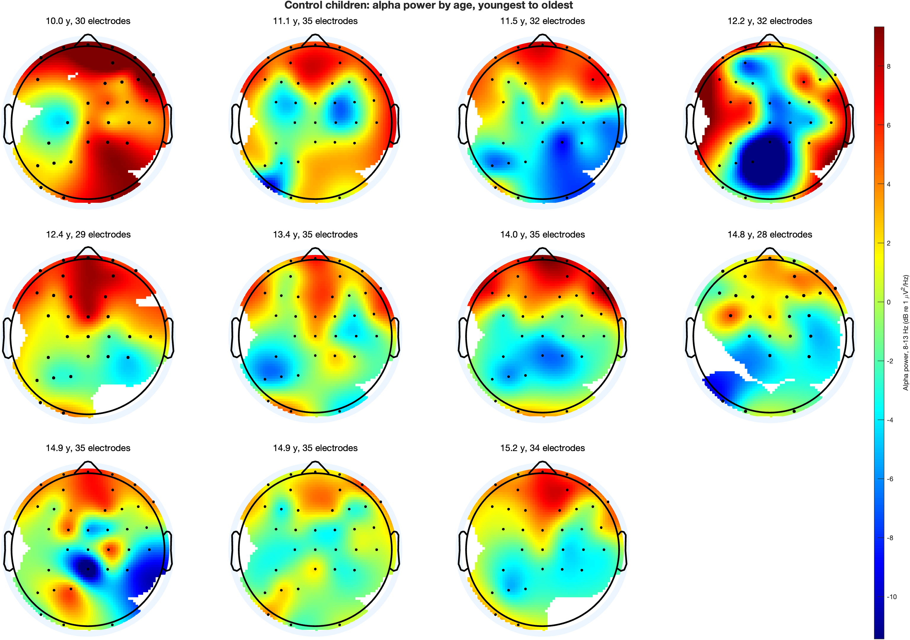 | 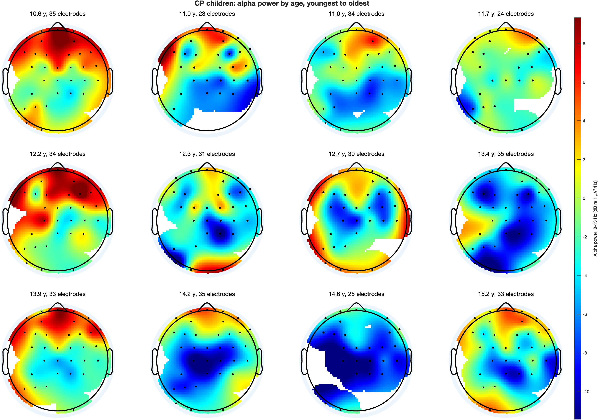 |
| Theta | 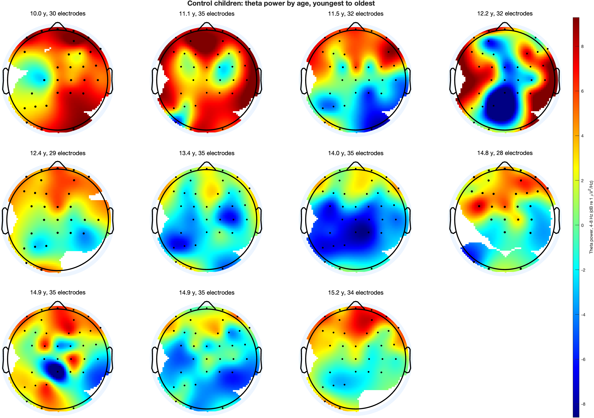 | 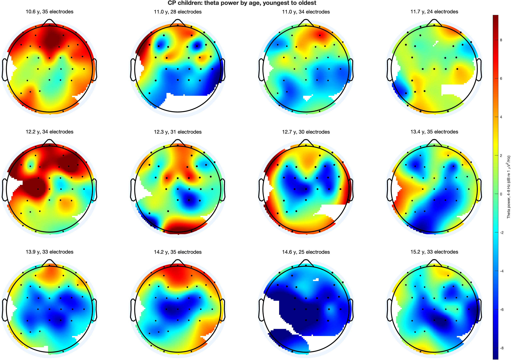 |
| Delta | 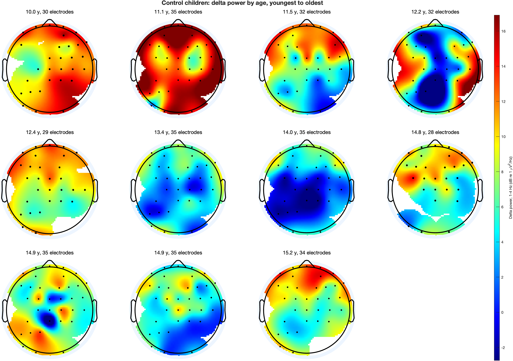 | 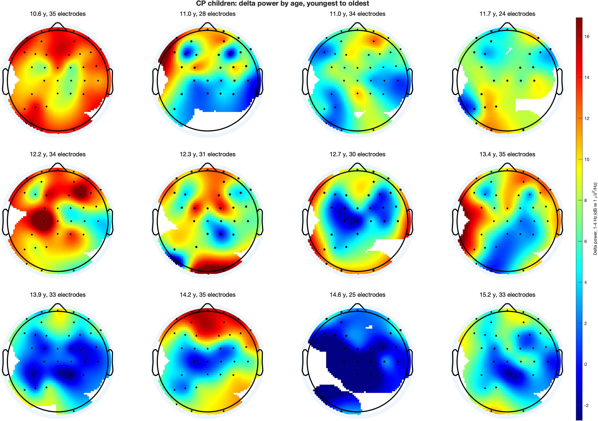 |

<details>
<summary><b>How the by-age maps are made</b></summary>

The same band power values as Figure 1, one map per child. A child needs at least 24 of the 35 drawn electrodes
(one control child has 23 and is left out). The colour scale runs from the 2nd to the 98th percentile of that band
in both groups, so one extreme electrode does not set it and the Control and CP figures compare. Titles give age
and the number of electrodes only.

</details>

### 4. Frontal vs occipital: where the groups differ
`run_area_tests.m`

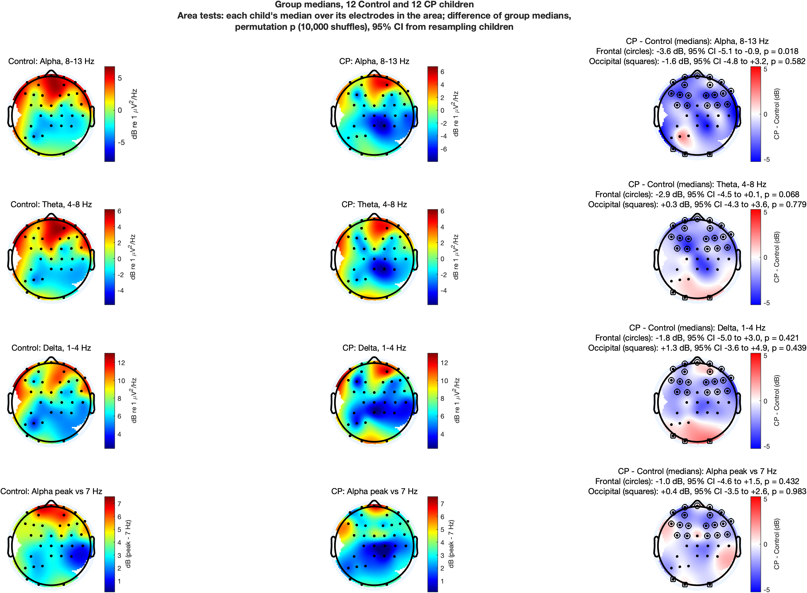

| Measure | Area | CP median | Control median | CP − Control | 95% CI | p |
|---|---|---|---|---|---|---|
| **Alpha** | **Frontal** | −0.3 dB | 3.3 dB | **−3.6 dB** | **−5.1 to −0.9** | **0.018** |
| Alpha | Occipital | −1.1 dB | 0.5 dB | −1.6 dB | −4.8 to +3.2 | 0.58 |
| Theta | Frontal | 0.8 dB | 3.7 dB | −2.9 dB | −4.5 to +0.1 | 0.068 |
| Theta | Occipital | 1.4 dB | 1.2 dB | +0.3 dB | −4.3 to +3.6 | 0.78 |
| Delta | Frontal | 7.1 dB | 8.9 dB | −1.8 dB | −5.0 to +3.0 | 0.42 |
| Delta | Occipital | 8.9 dB | 7.6 dB | +1.3 dB | −3.6 to +4.9 | 0.44 |
| Alpha peak vs 7 Hz | Frontal | 3.6 dB | 4.5 dB | −1.0 dB | −4.6 to +1.5 | 0.43 |
| Alpha peak vs 7 Hz | Occipital | 3.4 dB | 3.0 dB | +0.4 dB | −3.5 to +2.6 | 0.98 |

**Frontal alpha is lower in CP; occipital alpha is not.** This is the test of the group medians the maps show. The
frontal alpha difference stays significant after correcting for the two areas (Holm, p = 0.036). Frontal theta
points the same way, with a 95% CI that just reaches 0. Delta and alpha peak vs 7 Hz do not differ in either area.
Occipital estimates rest on only three electrodes and 10 to 12 children per group, so their CIs are wide: they show
no difference was detected, not that the groups are the same there.

<details>
<summary><b>How the area tests work</b></summary>

**Areas.** Frontal: the 19 drawn electrodes of the Fp, AF, F and FC rows (circles). Occipital: the 3 drawn
occipital and parieto-occipital electrodes, O1, O2 and PO7 (squares). The other occipital electrodes are usable in
too few children to be drawn. Frontal was chosen before the maps were made, because the published analyses and
anaesthesia alpha are frontal; occipital is the comparison.

**One value per child.** For each child, the median of their usable electrodes in the area,

```math
v_i = \mathrm{median}_{e \in \text{area, usable for child } i}\ x_{i,e}
```

A child needs at least 3 usable frontal electrodes, or 2 occipital ones, to count in that area. All 24 children
count frontally; 10 CP and 12 Control count occipitally.

**The difference of group medians,** the same quantity the maps compare:

```math
\Delta = \mathrm{median}_{i \in \text{CP}} v_i - \mathrm{median}_{i \in \text{Control}} v_i
```

**p-value: shuffling the labels.** If CP and Control did not differ, the labels would be arbitrary. The labels are
shuffled 10,000 times and Δ is recomputed each time, which shows how large a difference chance alone makes.
The p-value is the share of shuffles at least as far from 0 as the real one:

```math
p = \frac{1 + (\text{number of shuffles with } |\Delta_{\text{shuffled}}| \ge |\Delta|)}{10000 + 1}
```

**95% CI: resampling children.** Children are drawn with replacement within each group, 10,000 times, and
Δ is recomputed each time. The middle 95% of these values is the CI. It shows how much the difference would
change with a different sample of children (`subject_bootstrap_ci.m`).

Both use each child as one observation, so they ask whether the difference would hold for new children. On
simulated data with no difference, the test gave p < 0.05 in 3.5% of 200 datasets (5% is the target), and it
found a planted difference (`tests/test_stats.m`).

</details>

### 5. Frontal and occipital alpha across age
`run_area_state_space.m`

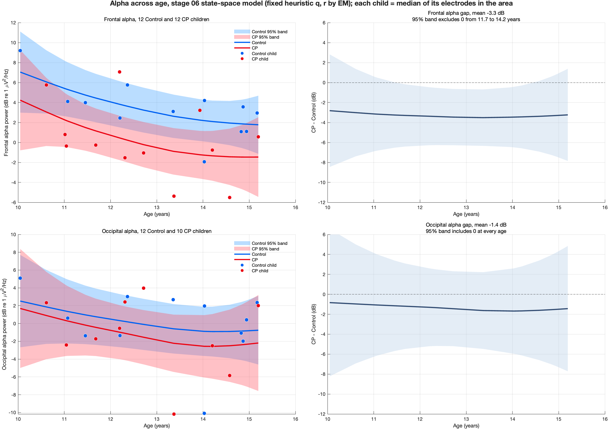

**Frontal alpha in CP sits below Control across the whole age range.** The gap averages −3.3 dB, and its 95%
credible band excludes 0 from 11.7 to 14.2 years. **Occipital alpha shows no gap** (average −1.4 dB, band includes 0
at every age). The frontal band is narrower in age than at F3 (11.5 to 14.9 years), because the frontal value mixes
in electrodes with weaker effects, and few children are at the youngest and oldest ages.

<details>
<summary><b>How the state-space model is used here</b></summary>

This is the stage 06 model, unchanged, with each child's frontal or occipital value (as in Figure 4) in place of F3.
It lines the children up by age and assumes the Control curve f₀(a) and the CP − Control gap δ(a) change
smoothly with age. Each child's value is their group's curve at their age plus noise:

```math
y_i = f_0(a_i) + g_i\,\delta(a_i) + \varepsilon_i, \qquad \varepsilon_i \sim \mathcal{N}(0, r), \qquad g_i = 1 \text{ for CP, } 0 \text{ for Control}
```

How smooth the curves are is set by q, with the published "fixed heuristic" setting

```math
q = \frac{(\text{range of } y)^2}{(\text{age span})^3}
```

and the noise variance r is estimated by EM. A Kalman smoother gives each
curve's posterior mean and 95% credible band (`state_space_fit.m`; the method is described in full on the stage 06
page). Where the band for the gap excludes 0, the model is at least 95% certain of its sign at that age. Given
stage 06's own input, this wrapper reproduces the published F3 result exactly (tests).

</details>

## Additional analyses

Descriptive figures and results that are not significant. They support the results above but are not claims.

### A1. State-space alpha maps at ages 11 to 15
`run_state_space_maps.m`

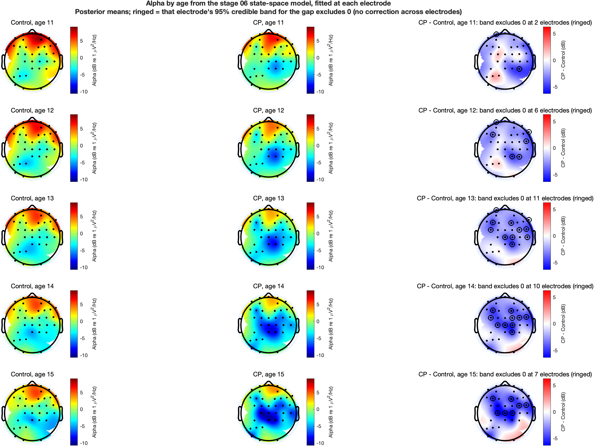

The stage 06 model fitted at every electrode, read off at ages 11 to 15. Ringed electrodes have a 95% credible band
for the gap that excludes 0: 2 at age 11, 6 at 12, 11 at 13, 10 at 14 and 7 at 15, mostly frontal and central, never
occipital. Each ring is that electrode's own band, with **no correction across the 35 electrodes**, so a few rings
could be chance. The gap looks larger at older ages (median −1.6 dB at 11 to −3.4 dB at 15), but at F3 and in the
regression the gap does not change with age, so this is more likely wider uncertainty at the young end than a trend.

<details>
<summary><b>How the maps are made</b></summary>

At each drawn electrode, `state_space_fit.m` fits the children with a usable alpha value there (the model of
Figure 5). The posterior means and bands are read off at each age by linear interpolation between neighbouring
children's ages, and not beyond the youngest or oldest child. The maps are drawn like Figure 1, with the gap on a
fixed −6 to 6 dB scale. At F3 the gap here averages −4.2 dB over ages 11 to 15, compared with −4.9 dB in stage 06: these maps use the full
120 s spectrum and leave out one control child's F3, which had too few Laplacian neighbours, while stage 06 averages
four 30 s sub-epochs and keeps every child.

</details>

### A2. Alpha peak vs 7 Hz, each child by age
`plot_band_by_age.m`

| Control | CP |
|---|---|
| 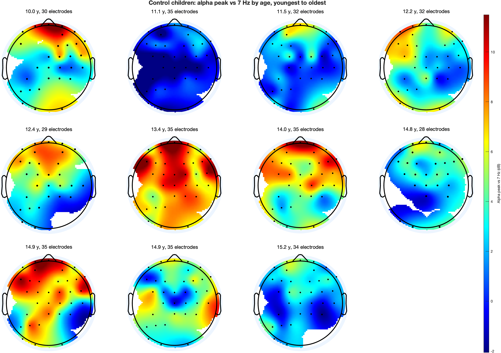 | 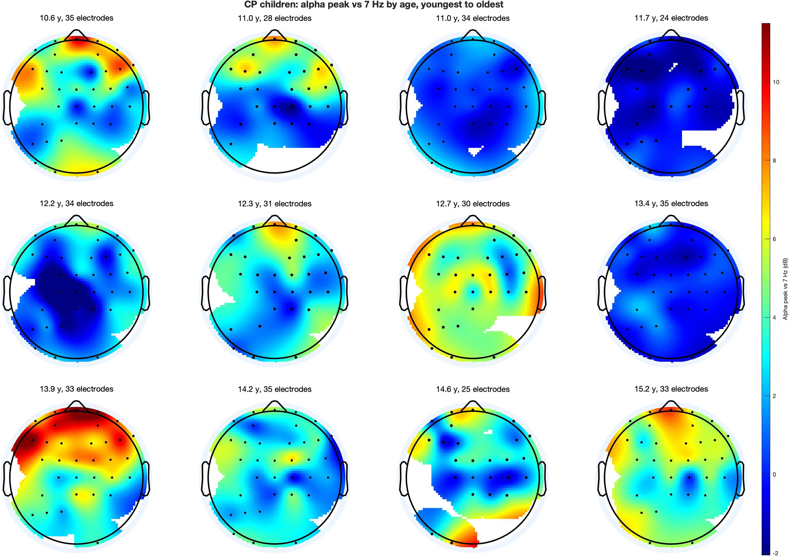 |

The height of the alpha peak varies a lot between children within each group: some have a strong frontal peak and
some almost none. This is why the group difference in peak height is not significant (Figures 2 and 4). Made as in
Figure 3.

### A3. Sensitivity: specparam alpha height
`run_specparam_topoplots.m`

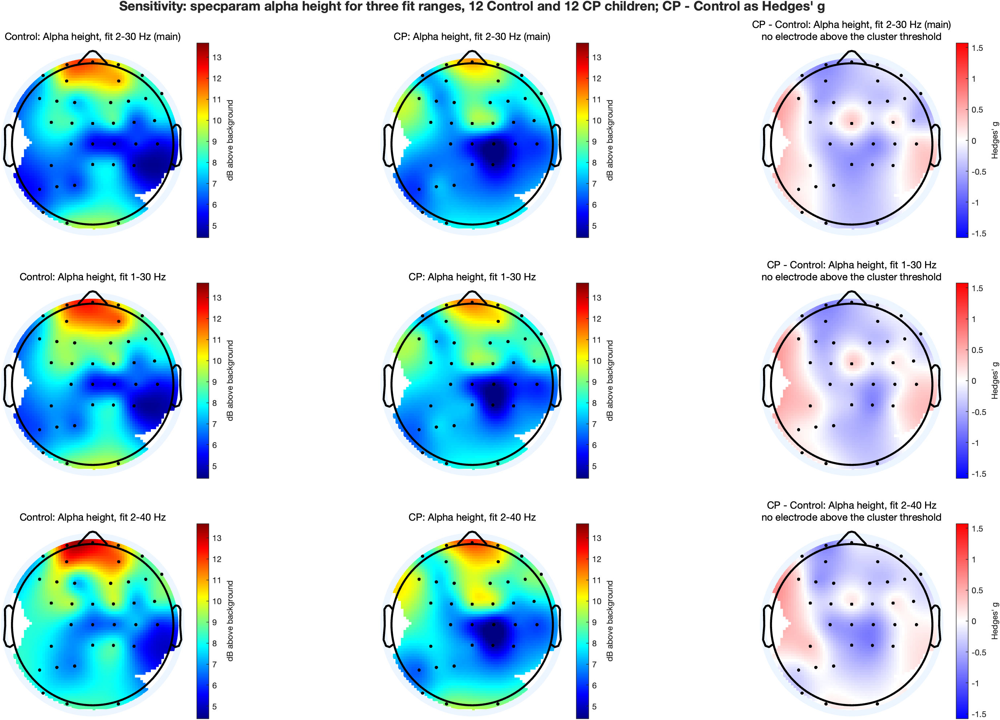

A second way to measure the alpha peak, as its height above the 1/f background. The three fit ranges give the same
picture: a small CP − Control difference (median effect size −0.20 to −0.26) and no cluster. So the result does not
depend on the fit range, and it agrees with alpha peak vs 7 Hz.

<details>
<summary><b>How specparam works</b></summary>

Specparam (FOOOF 1.1, Donoghue et al. 2020) splits each electrode's spectrum into a straight 1/f background and
peaks, on log axes:

```math
\log_{10} S(f) = b - \chi \log_{10} f + \sum_n a_n\, e^{-(f - c_n)^2 / (2 w_n^2)}
```

- b is the **offset** (the background's height at 1 Hz; reported in dB as 10·b),
- χ is the **exponent** (how steeply the background falls; larger is steeper),
- each peak has a height aₙ (reported in dB as 10·aₙ), centre cₙ and width wₙ.

**Alpha height** is the tallest peak from 7 to 13 Hz, in dB above the background. A child with no peak there gets
0, so they stay in the maps. The settings were fixed before any fit: peak widths 1 to 8 Hz, at most 6 peaks,
minimum height 0.1, fixed (straight) background. The main fit is 2–30 Hz; 1–30 and 2–40 Hz test whether the
choice of range matters (`fit_specparam.py`). The maps and statistics are those of Figure 1, with one colour
scale shared by the three rows.

</details>

### A4. Specparam background: offset and exponent
`run_specparam_topoplots.m`

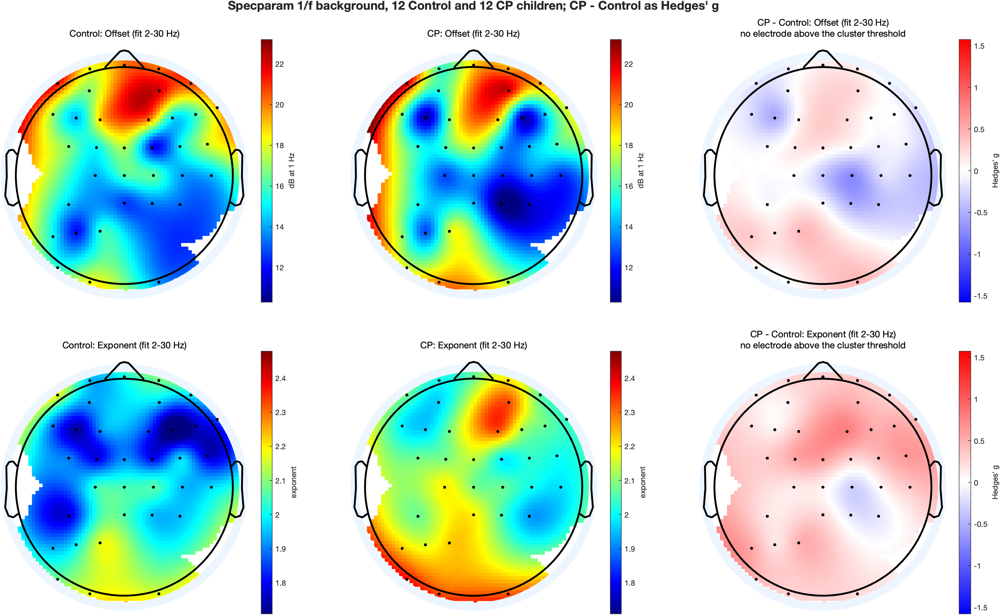

The background is not clearly different. The offset is about the same (median effect size −0.05). The exponent tends
to be higher in CP, meaning a steeper background, over most of the scalp (median effect size +0.29), but no
cluster reaches the threshold. Offset and exponent move together across children (a steeper line is usually fitted
with a higher start), so they are read together. Methods as in A3 and Figure 1.

### A5. Six scalp areas
`run_area_comparison.m`

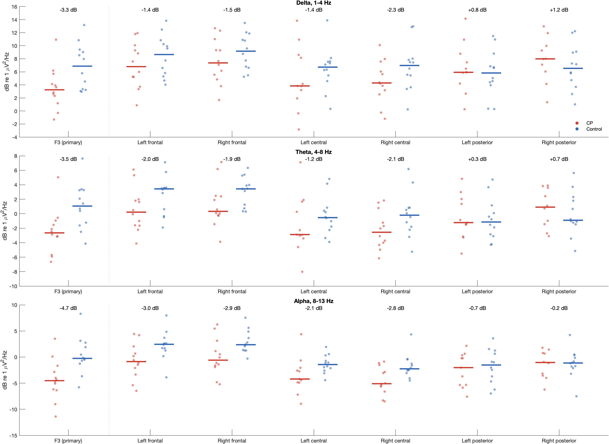

An earlier split into left and right frontal, central and posterior areas, with each child's mean over an area's
clean electrodes and rank-sum tests corrected over all 18 area × band tests (Holm). Alpha is lower in CP in the
frontal and central areas before correction (p = 0.02 to 0.03) and not posteriorly; none survives the correction
over 18 tests. Figure 4 replaces it as the main area test, because it compares the medians the maps show and makes
one frontal and one occipital comparison.

## Limits
- Positions are template positions, not each child's electrodes.
- Interpolation can overshoot next to a strong value, and the colour beyond the outermost electrodes is
  extrapolated.
- At the edge of the head the Laplacian is one-sided, so power there is less comparable with the middle.
- Each extra Laplacian neighbour lowers a channel's power by about 1.3 dB. The groups have similar counts
  (3.53 CP, 3.56 Control), so this matters more for single children than for the group difference.
- 12 children per group give wide confidence intervals; areas with few electrodes (occipital) even more so.

---
[← additional_coherence_state_space](additional_coherence_state_space.md)
